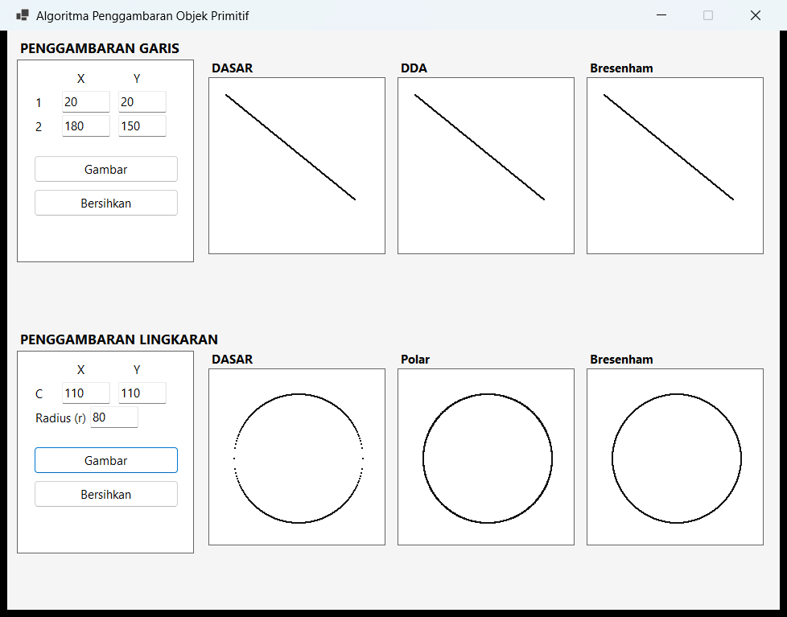
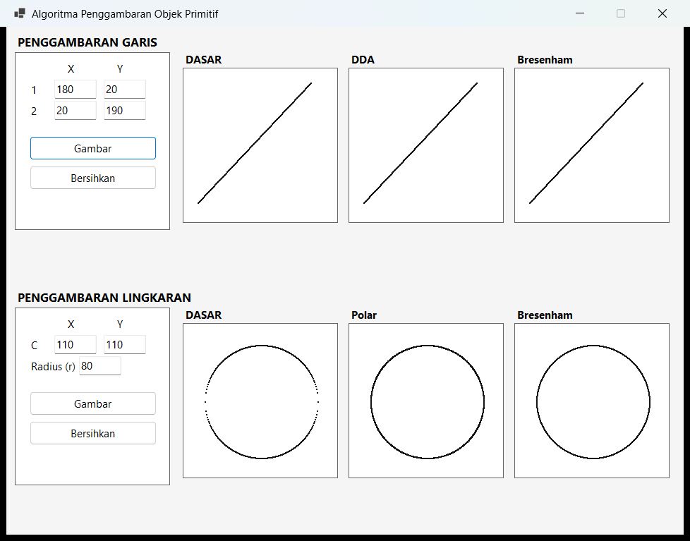

# LAPORAN PRAKTIKUM 2 — GRAFIKA KOMPUTER
## Algoritma Penggambaran Objek Primitif (Garis dan Lingkaran)

| Keterangan | Isi |
|---|---|
| **Mata Kuliah** | Grafika Komputer |
| **Modul** | Praktikum 2 — Algoritma Penggambaran Objek Primitif |
| **Nama** | Aulia |
| **NIM / Kelas** | ......................................... / ......................................... |
| **Dosen Pengampu** | ......................................... |
| **Bahasa / Framework** | C# Windows Forms (.NET 10 / GDI+) |
| **Nama Proyek** | `AuliaPrakGrafkom2` |

---

## 1. Tujuan Praktikum

1. Memahami dan mengimplementasikan tiga algoritma pembentukan garis, yaitu **Algoritma Garis Dasar**, **DDA (Digital Differential Analyzer)**, dan **Bresenham**.
2. Memahami dan mengimplementasikan tiga algoritma pembentukan lingkaran, yaitu **Algoritma Lingkaran Dasar**, **Polar**, dan **Bresenham (Midpoint Circle)**.
3. Mengintegrasikan keenam algoritma tersebut ke dalam satu aplikasi GUI C# Windows Forms sehingga hasil tiap algoritma dapat dibandingkan secara langsung pada kanvas yang berdampingan.
4. Memahami penerapan penggambaran primitif pada level piksel melalui fungsi `PutPixel` tanpa memanfaatkan fungsi grafika tingkat tinggi seperti `DrawLine` atau `DrawEllipse`.
5. Menganalisis perbedaan hasil antaralgoritma ditinjau dari **kerapatan piksel**, **akurasi pembulatan**, dan **efisiensi komputasi**.

---

## 2. Alat dan Bahan

- Komputer/laptop dengan Windows 10/11.
- .NET SDK 10.0 (atau versi yang mendukung Windows Forms).
- Visual Studio 2022/2026 **atau** Visual Studio Code.
- Bahasa C# dengan library GDI+ (`System.Drawing`).

---

## 3. Dasar Teori

### 3.1 Algoritma Garis Dasar (Algoritma 2.1)

Algoritma ini menggunakan persamaan garis lurus:

```
m = (y2 - y1) / (x2 - x1)
```

Nilai `x` diiterasi dari `x1` sampai `x2` dengan `Δx = 1`. Pada setiap langkah, nilai `y` dihitung secara inkremental:

```
y* = y + m
```

Piksel digambar pada koordinat `(x, round(y))`.

**Karakteristik:** paling sederhana, tetapi memakai operasi floating-point. Jika garis vertikal (`x1 == x2`), gradien tidak terdefinisi sehingga harus ditangani khusus. Untuk garis curam (`|m| > 1`), satu nilai `x` hanya menghasilkan satu piksel sehingga garis tampak putus-putus.

### 3.2 Algoritma Garis DDA (Algoritma 2.2)

DDA menentukan jumlah langkah berdasarkan selisih sumbu terpanjang:

```
dx = x2 - x1
dy = y2 - y1
s  = max(|dx|, |dy|)
Δx = dx / s
Δy = dy / s
```

Mulai dari `(x1, y1)`, setiap iterasi menggambar piksel pada `(round(x), round(y))`, kemudian menambahkan `Δx` dan `Δy`. Karena salah satu inkremen bernilai 1 pada sumbu dominan, garis tidak putus untuk semua kemiringan. Algoritma ini masih menggunakan bilangan pecahan.

### 3.3 Algoritma Garis Bresenham (Algoritma 2.3 — Semua 8 Oktan)

Bresenham bekerja sepenuhnya dengan **bilangan bulat**:

```
da = max(|dx|, |dy|)      // sumbu dominan
db = min(|dx|, |dy|)      // sumbu minor
∇  = 2·db - da            // parameter keputusan awal
```

Arah langkah ditentukan dari tanda `dx`, `dy`, dan perbandingan `|dx| ≥ |dy|`:

- `m1` = langkah lurus (hanya sumbu dominan),
- `m2` = langkah diagonal (kedua sumbu).

Setiap iterasi:

- jika `∇ ≥ 0` → ambil langkah diagonal `m2`, lalu `∇ = ∇ + 2·db − 2·da`;
- jika `∇ < 0` → ambil langkah lurus `m1`, lalu `∇ = ∇ + 2·db`.

Pendekatan ini berlaku untuk seluruh 8 oktan (semua arah dan kemiringan) tanpa pembagian.

### 3.4 Algoritma Lingkaran Dasar (Algoritma 2.4)

Berdasarkan persamaan lingkaran:

```
(x − xc)² + (y − yc)² = r²
y = yc ± √(r² − x²)
```

`x` diiterasi dari `−r` sampai `r`. Untuk setiap `x` dihitung dua nilai `y` (setengah atas dan setengah bawah), lalu digambar `(xc + x, round(y1))` dan `(xc + x, round(y2))`.

**Karakteristik:** memerlukan operasi akar kuadrat yang relatif mahal. Di sekitar `x = ±r` perubahan `y` sangat cepat, sehingga piksel pada sisi kiri/kanan lingkaran menjadi renggang.

### 3.5 Algoritma Lingkaran Polar (Algoritma 2.5)

Menggunakan koordinat polar:

```
x = xc + r·cos(θ)
y = yc + r·sin(θ)
```

Sudut `θ` diiterasi dari `0` sampai `2π` dengan langkah kecil. Pada implementasi ini digunakan:

```
Δθ = min(1/r, 0.005)
```

Tujuannya agar panjang busur antartitik tidak lebih dari satu satuan sehingga lingkaran rapat. Kerapatan piksel merata di seluruh keliling, tetapi setiap langkah membutuhkan perhitungan `sin` dan `cos` yang mahal.

### 3.6 Algoritma Lingkaran Bresenham (Algoritma 2.6 & 2.7)

Algoritma memanfaatkan **simetri 8 oktan**. Hanya satu oktan yang dihitung, lalu dicerminkan menjadi 8 titik melalui `DrawCirclePoints()`:

```
(xc + x, yc + y)   (xc − x, yc + y)
(xc + x, yc − y)   (xc − x, yc − y)
(xc + y, yc + x)   (xc − y, yc + x)
(xc + y, yc − x)   (xc − y, yc − x)
```

Inisialisasi dan perulangan:

```
x = 0, y = r, d = 3 − 2r
selama x ≤ y:
    x = x + 1
    jika d < 0 : d = d + 4x + 6
    selain itu : d = d + 4(x − y) + 10, y = y − 1
    gambar 8 titik simetris
```

Seluruh operasi menggunakan bilangan bulat sehingga cepat dan akurat.

---

## 4. Penjelasan Implementasi Kode dan Langkah-langkah Praktikum

### Langkah 1 — Membuat Proyek

Proyek dibuat sebagai aplikasi **C# Windows Forms** dengan target `net10.0-windows`. Seluruh komponen antarmuka dibangun **secara terprogram** di dalam `Form1.cs` (method `BuildUi()`), sehingga proyek dapat langsung dikompilasi tanpa menyusun komponen melalui drag-and-drop di Designer.

### Langkah 2 — Membangun Antarmuka (GUI)

Form utama berjudul **"Algoritma Penggambaran Objek Primitif"** dengan `ClientSize` 960 × 720 piksel, terbagi menjadi dua bagian vertikal:

| Bagian | Panel Input | Kanvas |
|---|---|---|
| **Atas — Garis** | `txtLineX1`, `txtLineY1`, `txtLineX2`, `txtLineY2`, `btnDrawLine`, `btnClearLine` | `pnlLineDasar` ("DASAR"), `pnlLineDDA` ("DDA"), `pnlLineBresenham` ("Bresenham") |
| **Bawah — Lingkaran** | `txtCircleXc`, `txtCircleYc`, `txtCircleRadius`, `btnDrawCircle`, `btnClearCircle` | `pnlCircleDasar` ("DASAR"), `pnlCirclePolar` ("Polar"), `pnlCircleBresenham` ("Bresenham") |

Setiap kanvas berukuran **220 × 220 piksel**, menggunakan `BorderStyle.FixedSingle`, dan `BackColor.White`. Nilai default input:

- Garis: `(20, 20)` → `(180, 150)`
- Lingkaran: pusat `(110, 110)`, radius `80`

### Langkah 3 — Helper `PutPixel`

Semua objek digambar piksel demi piksel melalui satu helper:

```csharp
private void PutPixel(Graphics g, int x, int y, Brush brush)
{
    g.FillRectangle(brush, x, y, 2, 2);
}
```

Ukuran 2 × 2 dipilih agar piksel lebih jelas terlihat pada layar beresolusi tinggi. Tidak ada pemanggilan `g.DrawLine()`, `g.DrawEllipse()`, atau fungsi bentuk bawaan lainnya untuk objek utama.

### Langkah 4 — Implementasi Algoritma Garis

| Method | Perlakuan khusus |
|---|---|
| `DrawLineDasar` | Menangani garis vertikal (`x1 == x2`) dan menukar titik jika `x1 > x2`; menghitung `m` bertipe `double` dan menambah `y` sebesar `m` setiap langkah. |
| `DrawLineDDA` | Menghitung `s = max(|dx|, |dy|)`, lalu `Δx = dx/s` dan `Δy = dy/s`; iterasi sebanyak `s + 1` titik. |
| `DrawLineBresenham` | Menentukan `da`, `db`, `∇`, serta vektor langkah `m1`/`m2`; seluruh keputusan memakai integer dan mendukung 8 oktan. |

Ketiga method dipanggil bersamaan dari `BtnDrawLine_Click` setelah validasi `int.TryParse`, masing-masing pada kanvasnya sendiri.

### Langkah 5 — Implementasi Algoritma Lingkaran

| Method | Perlakuan khusus |
|---|---|
| `DrawCircleDasar` | Iterasi `x = −r … r`; menghitung `yc ± √(r² − x²)`; dua piksel per nilai `x`. |
| `DrawCirclePolar` | Iterasi `θ = 0 … 2π` dengan `Δθ = min(1/r, 0.005)`; menghitung `xc + r·cos θ` dan `yc + r·sin θ`. |
| `DrawCircleBresenham` | Inisialisasi `x = 0`, `y = r`, `d = 3 − 2r`; memperbarui `d` dan memanggil `DrawCirclePoints` untuk 8 titik simetris selama `x ≤ y`. |

Validasi tambahan dilakukan pada radius: harus bilangan bulat dengan `1 ≤ r < 220` agar lingkaran tetap berada di dalam kanvas.

### Langkah 6 — Manajemen Bitmap Back-Buffer

Setiap kanvas memiliki `Bitmap` 220 × 220 yang disimpan dalam `Dictionary<Panel, Bitmap> canvasBuffers`. Seluruh algoritma menggambar ke Bitmap tersebut, bukan langsung ke layar. Event `Paint` hanya menjalankan:

```csharp
e.Graphics.DrawImageUnscaled(canvasBuffers[(Panel)s!], 0, 0);
```

Dengan mekanisme ini, gambar **tidak hilang** ketika jendela di-minimize, ditutup jendela lain, atau di-refresh. Satu objek `Graphics` dipakai untuk seluruh piksel dalam satu proses penggambaran agar kinerja tetap baik.

### Langkah 7 — Event Handler, Validasi, dan Pengujian

1. Tombol **"Gambar"** (garis/lingkaran) memvalidasi input dengan `int.TryParse`. Jika gagal, muncul `MessageBox` peringatan dan penggambaran dibatalkan.
2. Jika valid, kanvas dibersihkan, algoritma dijalankan pada masing-masing kanvas, lalu `Invalidate()` memicu repaint.
3. Tombol **"Bersihkan"** mengosongkan back-buffer dan me-refresh tampilan.
4. Pengujian dilakukan dengan data default, garis terbalik `(180, 20) → (20, 190)`, serta variasi radius.

---

## 5. Hasil Pengamatan

### 5.1 Tampilan Aplikasi



*Gambar 1. Hasil penggambaran garis `(20,20)–(180,150)` dan lingkaran pusat `(110,110)` dengan `r = 80` pada ketiga kanvas.*

### 5.2 Pengujian Garis Curam dan Arah Terbalik



*Gambar 2. Pengujian garis `(180,20) → (20,190)` (dx negatif, |dy| > |dx|) untuk membuktikan dukungan 8 oktan.*

### 5.3 Tabel Pengamatan Visual

| Algoritma | Hasil pada data uji | Catatan pengamatan |
|---|---|---|
| Garis Dasar | Garis terbentuk, tampak kontinu pada kemiringan sedang | Pada kemiringan sangat curam, jarak antarpiksel vertikal membesar (putus-putus) |
| Garis DDA | Rapat dan kontinu | Jumlah piksel mengikuti sumbu dominan |
| Garis Bresenham | Rapat, kontinu, bentuk sama dengan DDA | Tidak ada galat akumulasi floating-point |
| Lingkaran Dasar | Lingkaran terbentuk, **renggang di sisi kiri dan kanan** | Perubahan `y` sangat cepat saat `|x| → r` |
| Lingkaran Polar | Rapat dan merata | Jumlah titik paling banyak, khususnya untuk radius kecil |
| Lingkaran Bresenham | Rapat, halus, simetris | Hanya menghitung satu oktan, dicerminkan ke 8 titik |

---

## 6. Analisis Perbandingan Hasil

### 6.1 Perbandingan Algoritma Garis

| Aspek | Garis Dasar | DDA | Bresenham |
|---|---|---|---|
| **Tipe data** | Floating-point (`double`) | Floating-point (`double`) | Integer murni |
| **Operasi utama** | 1 pembagian + penambahan float + `Round` per piksel | 2 pembagian + 2 penambahan float + `Round` per piksel | Penjumlahan/pengurangan integer |
| **Jumlah iterasi** | `\|dx\| + 1` | `max(\|dx\|,\|dy\|) + 1` | `da + 1` |
| **Kerapatan piksel** | **Putus-putus** jika `\|m\| > 1` | Rapat untuk semua kemiringan | Rapat untuk semua kemiringan |
| **Akurasi** | Bergantung pembulatan `Math.Round` dan galat akumulasi `m` | Bergantung pembulatan tiap langkah | Tepat, tidak ada galat pembulatan |
| **Garis vertikal** | Harus ditangani khusus | Otomatis (`s = \|dy\|`) | Otomatis (sumbu Y dominan) |
| **8 oktan** | Ya, dengan penanganan swap/vertikal | Ya | Ya, eksplisit melalui `m1`/`m2` |
| **Efisiensi relatif** | Rendah | Sedang | **Tinggi** |

**Pembahasan.** Ketiga algoritma menghasilkan bentuk garis yang serupa pada kemiringan sedang, tetapi berbeda pada jumlah dan sebaran piksel. Algoritma Dasar hanya menggambar satu piksel untuk setiap kolom `x`, sehingga ketika `|m| > 1` terdapat lompatan nilai `y` yang meninggalkan celah. DDA memperbaikinya dengan memilih sumbu dominan sebagai basis langkah, sehingga jarak antarpiksel selalu ≤ 1 satuan. Bresenham menghasilkan geometri yang sama dengan DDA, tetapi mengganti pembagian dan pembulatan floating-point dengan parameter keputusan integer. Pada data uji garis `(20,20)–(180,150)`, Dasar dan DDA sama-sama melakukan 161 iterasi, sedangkan pada garis curam `(180,20)–(20,190)` Dasar tetap 161 iterasi (lebih sedikit piksel karena celah), sedangkan DDA/Bresenham melakukan 171 iterasi agar garis tetap rapat.

### 6.2 Perbandingan Algoritma Lingkaran

| Aspek | Lingkaran Dasar | Polar | Bresenham |
|---|---|---|---|
| **Tipe data** | Floating-point (`sqrt`) | Floating-point (`sin`, `cos`) | Integer murni |
| **Operasi utama** | 1 akar kuadrat per nilai `x` | 2 fungsi trigonometri per langkah | Penambahan/pengurangan integer |
| **Jumlah iterasi (r = 80)** | 161 (2 piksel/iterasi ≈ 322 piksel) | ≈ 1257 (step 0.005 rad) | ≈ 57 (8 piksel/iterasi ≈ 456 piksel) |
| **Kerapatan piksel** | **Renggang di sisi kiri/kanan** | Merata di seluruh keliling | Merata dan simetris |
| **Akurasi** | Baik, bergantung pembulatan | Baik, bergantung besar `Δθ` | Tepat (integer) |
| **Pemanfaatan simetri** | Tidak | Tidak | Ya, 8 oktan |
| **Efisiensi relatif** | Rendah (sqrt mahal) | Rendah (trigonometri mahal) | **Tinggi** |

**Pembahasan.** Lingkaran Dasar menghitung `y` dari `x`, sehingga di dekat titik terlebar (`|x| ≈ r`) turunan `dy/dx` menuju tak hingga dan piksel melompat secara vertikal. Fenomena ini terlihat jelas pada Gambar 1, yaitu bagian kiri dan kanan lingkaran tampak terputus. Algoritma Polar mengatasi masalah tersebut karena iterasi dilakukan terhadap sudut, sehingga panjang busur antartitik relatif seragam; konsekuensinya, jumlah titik yang dihitung jauh lebih banyak dan setiap titik memerlukan `sin`/`cos`. Lingkaran Bresenham menghitung hanya satu oktan (sekitar `r/√2` iterasi) dan memanfaatkan simetri untuk menghasilkan 8 piksel sekaligus, sehingga menghasilkan lingkaran rapat dengan biaya komputasi paling rendah.

### 6.3 Perbandingan Efisiensi Komputasi

| Kriteria | Garis Dasar | DDA | Garis Bresenham | Lingkaran Dasar | Polar | Lingkaran Bresenham |
|---|---|---|---|---|---|---|
| Operasi floating-point | Ya | Ya | **Tidak** | Ya | Ya | **Tidak** |
| Pembagian | Ya | Ya | **Tidak** | Ya (implisit) | Ya | **Tidak** |
| Akar kuadrat | Tidak | Tidak | Tidak | **Ya** | Tidak | Tidak |
| Trigonometri | Tidak | Tidak | Tidak | Tidak | **Ya** | Tidak |
| Pembulatan `Round` | Ya | Ya | Tidak | Ya | Ya | Tidak |
| Kompleksitas | O(\|dx\|) | O(max(\|dx\|,\|dy\|)) | O(max(\|dx\|,\|dy\|)) | O(r) | O(2π/Δθ) | O(r) |
| Beban per piksel | Sedang | Sedang | **Ringan** | Berat | Berat | **Ringan** |

**Pembahasan.** Semua algoritma memiliki kompleksitas linear terhadap ukuran objek, tetapi konstanta biayanya berbeda. Operasi floating-point, akar kuadrat, dan trigonometri jauh lebih mahal dibanding penjumlahan integer. Selain itu, Bresenham lingkaran menggambar 8 piksel per iterasi sehingga jumlah iterasi efektifnya hanya sekitar sepertiga dari algoritma lain. Oleh karena itu, pada aplikasi grafika yang menuntut kecepatan (misalnya render ribuan objek per frame), Bresenham menjadi pilihan utama.

### 6.4 Kesimpulan Analisis

1. **Kerapatan piksel:** DDA dan Bresenham (garis) selalu rapat pada semua kemiringan; Algoritma Dasar putus-putus untuk `|m| > 1`. Untuk lingkaran, Polar dan Bresenham rapat dan merata, sedangkan Algoritma Dasar renggang di sisi kiri/kanan.
2. **Akurasi:** Bresenham paling akurat karena seluruh keputusan menggunakan integer tanpa galat pembulatan. DDA dan Polar cukup akurat dengan galat kecil akibat pembulatan/step sudut. Algoritma Dasar paling rentan terhadap galat akumulasi dan keterbatasan domain.
3. **Efisiensi:** Urutan dari paling efisien ke paling mahal adalah **Bresenham → DDA → Dasar** untuk garis, dan **Bresenham → Polar/Dasar** untuk lingkaran (keduanya mahal karena `sqrt`/trigonometri, dengan karakteristik kekurangan berbeda).
4. **Kemudahan implementasi:** Algoritma Dasar paling mudah dipahami secara matematis, tetapi membutuhkan penanganan kasus khusus. Bresenham lebih kompleks secara logika, tetapi memberikan hasil terbaik secara keseluruhan.

---

## 7. Kesimpulan Praktikum

1. Keenam algoritma berhasil diimplementasikan menggunakan C# Windows Forms dan GDI+ dengan penggambaran level piksel melalui `PutPixel`.
2. Integrasi keenam algoritma dalam satu GUI memudahkan perbandingan visual secara langsung karena objek yang sama digambar pada kanvas terpisah dengan ukuran identik.
3. Penggunaan Bitmap sebagai back-buffer terbukti menjaga gambar tetap tampil saat form di-refresh atau di-minimize.
4. Algoritma Bresenham (garis maupun lingkaran) merupakan algoritma paling efisien dan akurat karena hanya menggunakan operasi integer; DDA dan Polar menjadi alternatif yang baik secara visual namun lebih mahal secara komputasi; Algoritma Dasar paling sederhana namun memiliki keterbatasan pada garis curam dan sisi lingkaran.

---

## 8. Lampiran

### 8.1 Struktur Proyek

```
AuliaPrakGrafkom2/
├── AuliaPrakGrafkom2.slnx
├── LAPORAN_PRAKTIKUM.md
├── README.md
├── docs/
│   ├── hasil-garis-lingkaran.png
│   └── hasil-garis-curam.png
└── AuliaPrakGrafkom2/
    ├── AuliaPrakGrafkom2.csproj
    ├── Program.cs
    ├── Form1.cs
    ├── Form1.Designer.cs
    └── Form1.resx
```

### 8.2 Pemetaan Algoritma ke Method

| No. | Algoritma | Method |
|---|---|---|
| 1 | Garis Dasar (2.1) | `DrawLineDasar` |
| 2 | Garis DDA (2.2) | `DrawLineDDA` |
| 3 | Garis Bresenham (2.3) | `DrawLineBresenham` |
| 4 | Lingkaran Dasar (2.4) | `DrawCircleDasar` |
| 5 | Lingkaran Polar (2.5) | `DrawCirclePolar` |
| 6 | Lingkaran Bresenham (2.6 & 2.7) | `DrawCircleBresenham` + `DrawCirclePoints` |

### 8.3 Catatan Pengujian

- Garis vertikal (`x1 == x2`) diuji dan ditangani khusus oleh Algoritma Dasar.
- Garis dengan arah terbalik dan kemiringan curam diuji untuk memastikan Bresenham bekerja pada seluruh 8 oktan.
- Radius divalidasi agar tidak melebihi ukuran kanvas dan tidak bernilai nol/negatif.
