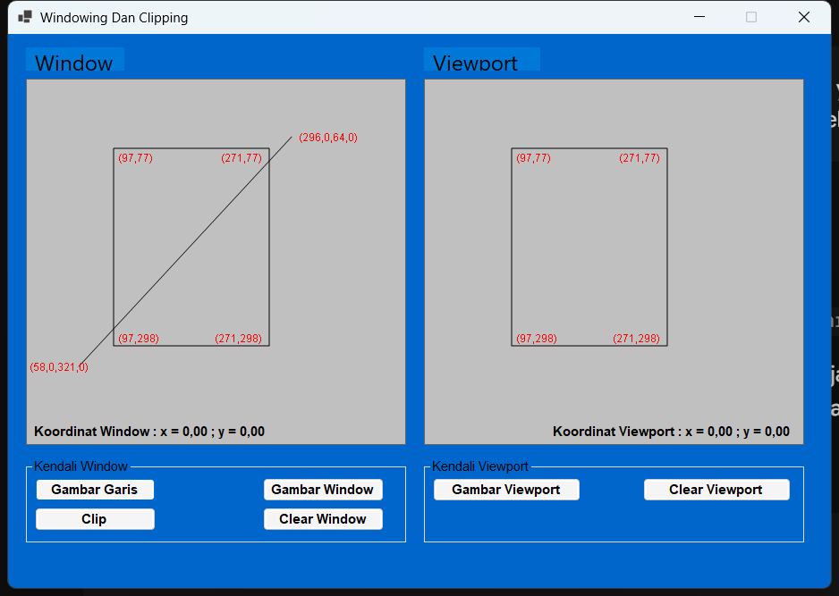
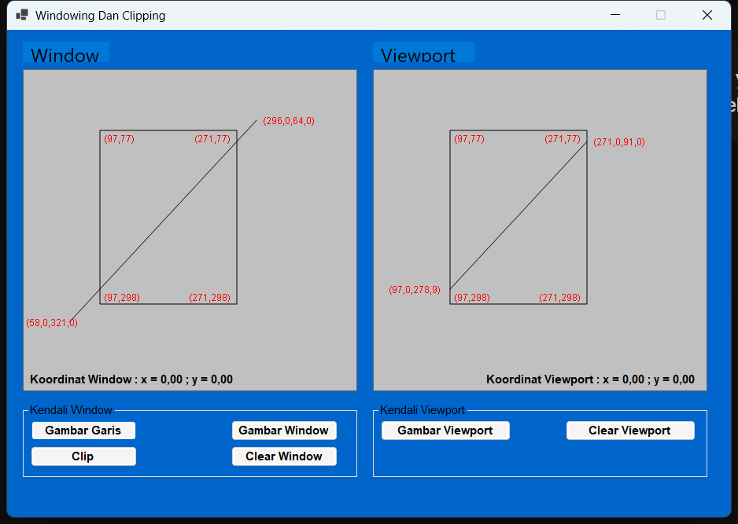

# LAPORAN PRAKTIKUM 3 — GRAFIKA KOMPUTER

## Windowing dan Clipping
### Implementasi Algoritma Cohen–Sutherland dan Transformasi Window-to-Viewport pada Aplikasi Desktop C# Windows Forms

| Keterangan | Isi |
|---|---|
| Mata Kuliah | Grafika Komputer |
| Praktikum | 3 (3.4) — Windowing dan Clipping |
| Nama | Aulia |
| Nama Proyek | `AuliaPrakGrafkom3` |
| Teknologi | C# · .NET 10 · Windows Forms · GDI+ |
| Judul Aplikasi | **Windowing Dan Clipping** |
| Repositori | `C:\Users\HP\source\repos\AuliaPrakGrafkom3` |
| IDE | Visual Studio 2022 / Visual Studio Code / .NET CLI |

---

## 1. Tujuan Praktikum

1. Memahami konsep **windowing**, yaitu pemilihan sebagian area dunia (*world space*) untuk ditampilkan pada perangkat keluaran.
2. Memahami konsep **viewport**, yaitu area tampilan pada perangkat keluaran tempat hasil window dipetakan.
3. Memahami proses **clipping** objek garis terhadap batas sebuah clip window.
4. Mengimplementasikan algoritma **Cohen–Sutherland** dengan *region code* 4-bit (*outcode*) untuk menentukan status garis:
   - *trivial accept* (seluruh garis di dalam window),
   - *trivial reject* (seluruh garis di luar window), dan
   - *clipped* (sebagian garis berada di dalam window).
5. Mengimplementasikan **transformasi Window-to-Viewport** untuk memetakan koordinat garis hasil clipping ke koordinat viewport.
6. Membangun aplikasi desktop interaktif berbasis **C# Windows Forms dan GDI+** dengan tata letak yang identik dengan gambar referensi modul Praktikum 3.
7. Membuktikan secara matematis titik potong garis default `(58, 321) → (296, 64)` terhadap window `(97, 77) – (271, 298)`, yaitu **`(97.0, 278.9)`** dan **`(271.0, 91.0)`**, serta membandingkannya dengan keluaran aplikasi.

---

## 2. Dasar Teori

### 2.1 Koordinat Dunia, Window, dan Viewport

Objek grafis pada dasarnya didefinisikan dalam **koordinat dunia** (*world coordinates*) yang bersifat kontinu dan tidak bergantung pada perangkat keluaran. Agar objek dapat ditampilkan pada layar, sebagian area dunia dipilih melalui sebuah **window**:

$$
W = [x_{wmin}, x_{wmax}] \times [y_{wmin}, y_{wmax}]
$$

Window tersebut kemudian dipetakan ke area pada perangkat keluaran yang disebut **viewport**:

$$
V = [x_{vmin}, x_{vmax}] \times [y_{vmin}, y_{vmax}]
$$

Dengan demikian:

- **Windowing** menentukan **apa** yang terlihat.
- **Viewport** menentukan **di mana** dan **seberapa besar** hasilnya ditampilkan.

Objek yang berada di luar window tidak ikut ditampilkan. Agar proses penggambaran efisien, bagian objek yang berada di luar window dipotong terlebih dahulu melalui proses **clipping**.

### 2.2 Transformasi Window-to-Viewport

Transformasi Window-to-Viewport memetakan setiap titik $(x_w, y_w)$ di dalam window ke titik $(x_v, y_v)$ di dalam viewport. Langkah pertama adalah menghitung faktor skala:

$$
s_x = \frac{x_{vmax} - x_{vmin}}{x_{wmax} - x_{wmin}}
$$

$$
s_y = \frac{y_{vmax} - y_{vmin}}{y_{wmax} - y_{wmin}}
$$

Kemudian titik dipetakan dengan rumus:

$$
\boxed{
x_v = x_{vmin} + (x_w - x_{wmin}) \cdot s_x
}
$$

$$
\boxed{
y_v = y_{vmin} + (y_w - y_{wmin}) \cdot s_y
}
$$

Atau dalam bentuk lengkap:

$$
x_v = x_{vmin} + (x_w - x_{wmin}) \cdot \frac{x_{vmax} - x_{vmin}}{x_{wmax} - x_{wmin}}
$$

$$
y_v = y_{vmin} + (y_w - y_{wmin}) \cdot \frac{y_{vmax} - y_{vmin}}{y_{wmax} - y_{wmin}}
$$

Rumus tersebut merupakan gabungan dari:

1. **Translasi** titik terhadap titik asal window, yaitu $(x_w - x_{wmin}, y_w - y_{wmin})$.
2. **Penskalaan** dengan faktor $s_x$ dan $s_y$.
3. **Translasi** ke posisi viewport, yaitu $(x_{vmin}, y_{vmin})$.

Jika rasio lebar dan tinggi viewport sama dengan rasio window, objek tidak mengalami distorsi. Jika rasio keduanya berbeda, objek akan mengalami peregangan (*stretching*) secara horizontal atau vertikal.

### 2.3 Konsep Clipping

**Clipping** adalah proses menghilangkan bagian objek yang berada di luar batas clip window. Untuk objek garis, hasil clipping dapat berupa:

| Kasus | Kondisi | Tindakan |
|---|---|---|
| **Trivial accept** | Kedua ujung garis berada di dalam window | Garis ditampilkan seluruhnya tanpa pemotongan |
| **Trivial reject** | Kedua ujung berada pada sisi luar yang sama | Garis dibuang seluruhnya |
| **Clipped** | Sebagian garis berada di dalam window | Garis dipotong pada satu atau dua titik batas |

Clipping dilakukan **sebelum** transformasi ke viewport dan sebelum rasterisasi. Tujuannya agar perhitungan transformasi serta penggambaran hanya dilakukan pada bagian yang benar-benar terlihat.

### 2.4 Algoritma Cohen–Sutherland

Algoritma Cohen–Sutherland membagi bidang di sekitar window menjadi **sembilan region**. Setiap titik diberi **outcode 4-bit** yang menyatakan posisinya terhadap keempat batas window.

#### 2.4.1 Konstanta Outcode

| Bit | Nilai | Nama | Kondisi pada sistem koordinat GDI+ |
|---|---:|---|---|
| 3 | 8 | `TOP` | `y < ymin` (titik berada di atas window) |
| 2 | 4 | `BOTTOM` | `y > ymax` (titik berada di bawah window) |
| 1 | 2 | `RIGHT` | `x > xmax` |
| 0 | 1 | `LEFT` | `x < xmin` |

Kode `0000` (`INSIDE = 0`) berarti titik berada di dalam window.

> **Catatan penting:** Pada sistem koordinat matematika, sumbu $Y$ membesar ke atas sehingga `TOP` berarti `y > ymax`. Pada **GDI+**, sumbu $Y$ membesar **ke bawah**. Oleh karena itu, implementasi pada aplikasi ini menggunakan:
>
> - `TOP` jika `y < ymin`,
> - `BOTTOM` jika `y > ymax`.
>
> Perbedaan ini harus diperhatikan agar hasil clipping tidak terbalik.

#### 2.4.2 Aturan Keputusan

Untuk sepasang titik ujung garis $P_0$ dan $P_1$ dengan outcode $c_0$ dan $c_1$:

1. Jika $(c_0 \mid c_1) = 0000$, maka **trivial accept**. Kedua titik berada di dalam window.
2. Jika $(c_0 \ \& \ c_1) \neq 0000$, maka **trivial reject**. Kedua titik berada pada sisi luar yang sama.
3. Selain itu, pilih salah satu titik yang berada di luar window, hitung titik potongnya dengan batas window yang sesuai, lalu ganti titik tersebut dengan titik potong. Proses diulang sampai kedua ujung berada di dalam window atau garis terbukti ditolak.

#### 2.4.3 Rumus Titik Potong

Titik potong dihitung menggunakan interpolasi linear (perbandingan segitiga sebangun).

**Terhadap batas atas** $(y = y_{min})$:

$$
x = x_0 + (x_1 - x_0)\frac{y_{min} - y_0}{y_1 - y_0}
$$

**Terhadap batas bawah** $(y = y_{max})$:

$$
x = x_0 + (x_1 - x_0)\frac{y_{max} - y_0}{y_1 - y_0}
$$

**Terhadap batas kiri** $(x = x_{min})$:

$$
y = y_0 + (y_1 - y_0)\frac{x_{min} - x_0}{x_1 - x_0}
$$

**Terhadap batas kanan** $(x = x_{max})$:

$$
y = y_0 + (y_1 - y_0)\frac{x_{max} - x_0}{x_1 - x_0}
$$

#### 2.4.4 Pseudocode

```text
function ClipLine(P0, P1, window):
    c0 = ComputeOutCode(P0)
    c1 = ComputeOutCode(P1)

    loop:
        if (c0 OR c1) == 0:
            return accepted(P0, P1)
        if (c0 AND c1) != 0:
            return rejected

        pilih titik luar = c0 != 0 ? P0 : P1

        if titik luar memiliki bit TOP:
            y = ymin
            x = interpolasi terhadap ymin
        else if titik luar memiliki bit BOTTOM:
            y = ymax
            x = interpolasi terhadap ymax
        else if titik luar memiliki bit RIGHT:
            x = xmax
            y = interpolasi terhadap xmax
        else if titik luar memiliki bit LEFT:
            x = xmin
            y = interpolasi terhadap xmin

        ganti titik luar dengan (x, y)
        hitung ulang outcode titik tersebut
```

Algoritma ini efisien karena banyak garis dapat diterima atau ditolak tanpa melakukan perhitungan titik potong sama sekali.

### 2.5 Back-Buffer dan Double Buffering GDI+

Penggambaran langsung ke kontrol pada setiap event `Paint` dapat menyebabkan kedipan (*flicker*) dan kehilangan gambar ketika form di-minimize atau ditutup sebagian oleh jendela lain. Salah satu solusinya adalah **back-buffer**:

1. Seluruh objek digambar ke sebuah `Bitmap` di memori.
2. Pada event `Paint`, isi `Bitmap` ditampilkan ke layar dengan `DrawImageUnscaled`.
3. Ketika form di-refresh, `Paint` cukup menampilkan kembali `Bitmap` yang sama.

Pada aplikasi ini, setiap kanvas menggunakan kelas `CanvasPanel` yang memiliki `Bitmap` internal. Dengan demikian, gambar tetap tersimpan meskipun form di-minimize, di-refresh, atau ditutup sebagian.

---

## 3. Perancangan Aplikasi

### 3.1 Tata Letak Antarmuka

Seluruh kontrol dibangun secara programatik di dalam `Form1.cs` tanpa menggunakan Designer.

| Kontrol | Properti / Posisi |
|---|---|
| Form `Form1` | Judul `Windowing Dan Clipping`, client area `920 × 620`, `FixedSingle`, `CenterScreen`, `BackColor = (0, 102, 204)` |
| `lblTitleWindow` | `Window`, posisi `(20, 15)`, font Segoe UI 14 pt, `ForeColor = Black`, `BackColor = (0, 120, 215)` |
| `lblTitleViewport` | `Viewport`, posisi `(465, 15)`, font Segoe UI 14 pt, `ForeColor = Black`, `BackColor = (0, 120, 215)` |
| `pnlWindow` | `(20, 50)`, ukuran `425 × 410`, `BackColor = Silver`, `FixedSingle` |
| `lblCoordWindow` | Di dalam `pnlWindow`, posisi `(5, 385)`, Arial 9 pt Bold, teks awal `Koordinat Window : x = 0,00 ; y = 0,00` |
| `pnlViewport` | `(465, 50)`, ukuran `425 × 410`, `BackColor = Silver`, `FixedSingle` |
| `lblCoordViewport` | Di dalam `pnlViewport`, posisi `(140, 385)`, Arial 9 pt Bold, teks awal `Koordinat Viewport : x = 0,00 ; y = 0,00` |
| `grpKendaliWindow` | `Kendali Window`, posisi `(20, 475)`, ukuran `425 × 95`, `ForeColor = Black` |
| `grpKendaliViewport` | `Kendali Viewport`, posisi `(465, 475)`, ukuran `425 × 95`, `ForeColor = Black` |

Tombol pada **Kendali Window**:

| Tombol | Teks | Posisi | Ukuran |
|---|---|---|---|
| `btnGambarGaris` | Gambar Garis | `(10, 22)` | `135 × 26` |
| `btnClip` | Clip | `(10, 55)` | `135 × 26` |
| `btnGambarWindow` | Gambar Window | `(265, 22)` | `135 × 26` |
| `btnClearWindow` | Clear Window | `(265, 55)` | `135 × 26` |

Tombol pada **Kendali Viewport**:

| Tombol | Teks | Posisi | Ukuran |
|---|---|---|---|
| `btnGambarViewport` | Gambar Viewport | `(10, 22)` | `165 × 26` |
| `btnClearViewport` | Clear Viewport | `(245, 22)` | `165 × 26` |

Semua tombol menggunakan `BackColor = WhiteSmoke`, `ForeColor = Black`, `FlatStyle = FlatStyle.Standard`, dan font Arial 8.5 pt Bold.

### 3.2 Nilai Default

Nilai default dipilih agar hasilnya langsung sama dengan gambar contoh pada modul:

| Objek | Nilai Default |
|---|---|
| Window | `xmin = 97`, `ymin = 77`, `xmax = 271`, `ymax = 298` |
| Garis | `P0 = (58.0, 321.0)`, `P1 = (296.0, 64.0)` |
| Viewport | `xvmin = 97`, `yvmin = 77`, `xvmax = 271`, `yvmax = 298` |

Dengan nilai tersebut, hasil clipping yang diharapkan adalah:

- titik potong pertama: **`(97.0, 278.9)`**,
- titik potong kedua: **`(271.0, 91.0)`**.

### 3.3 Alur Interaksi

| Aksi | Mode | Efek |
|---|---|---|
| Klik **Gambar Window** | `Window` | Menampilkan window default; pengguna dapat melakukan *drag* pada kanvas kiri untuk membuat window baru |
| Klik **Gambar Garis** | `Line` | Menampilkan garis default; pengguna dapat melakukan *drag* pada kanvas kiri untuk membuat garis baru |
| Klik **Gambar Viewport** | `Viewport` | Menampilkan viewport default; pengguna dapat melakukan *drag* pada kanvas kanan untuk membuat viewport baru |
| Klik **Clip** | — | Menjalankan Cohen–Sutherland, memetakan hasil ke viewport, lalu menggambar garis hasil clipping |
| Klik **Clear Window** | — | Mengosongkan kanvas kiri |
| Klik **Clear Viewport** | — | Mengosongkan kanvas kanan dan menghapus hasil clipping |

Label koordinat di dalam kanvas diperbarui secara *real-time* ketika kursor mouse bergerak di atas kanvas yang bersangkutan. Format yang digunakan adalah dua angka desimal dengan pemisah koma, misalnya:

```text
Koordinat Window : x = 97,00 ; y = 77,00
```

### 3.4 Struktur Berkas

| Berkas | Fungsi |
|---|---|
| `Program.cs` | Titik masuk aplikasi dan penanganan error saat startup |
| `Form1.cs` | Seluruh UI, kanvas back-buffer, interaksi mouse, algoritma Cohen–Sutherland, transformasi Window-to-Viewport, dan label koordinat merah |
| `LAPORAN.md` | Laporan praktikum ini |
| `README.md` | Petunjuk singkat menjalankan aplikasi |
| `docs/screenshot.png` | Tampilan awal aplikasi |
| `docs/screenshot-clip.png` | Tampilan setelah tombol **Clip** ditekan |

---

## 4. Penjelasan Source Code

### 4.1 `Program.cs` — Titik Masuk Aplikasi

```csharp
[STAThread]
private static void Main()
{
    ApplicationConfiguration.Initialize();

    try
    {
        Application.Run(new Form1());
    }
    catch (Exception ex)
    {
        // Menulis log ke %TEMP% dan menampilkan pesan error.
    }
}
```

`ApplicationConfiguration.Initialize()` mengatur konfigurasi WinForms seperti DPI, visual styles, dan font default. Setelah itu, `Application.Run(new Form1())` menjalankan form utama.

### 4.2 `Form1.BuildUi()` — Membangun UI Secara Programatik

Seluruh kontrol dibuat dan diposisikan secara eksplisit. Contoh pembuatan form dan kanvas kiri:

```csharp
Text = "Windowing Dan Clipping";
ClientSize = new Size(920, 620);
FormBorderStyle = FormBorderStyle.FixedSingle;
StartPosition = FormStartPosition.CenterScreen;
BackColor = Color.FromArgb(0, 102, 204);
AutoScaleMode = AutoScaleMode.None;

pnlWindow = new CanvasPanel
{
    Location = new Point(20, 50),
    Size = new Size(425, 410),
    BackColor = Color.Silver,
    BorderStyle = BorderStyle.FixedSingle,
    Cursor = Cursors.Cross
};
```

Karena `AutoScaleMode` diatur ke `None`, posisi dan ukuran kontrol tidak berubah akibat penskalaan otomatis. Semua koordinat mengikuti spesifikasi modul.

### 4.3 `CanvasPanel` — Kanvas dengan Back-Buffer Bitmap

```csharp
internal sealed class CanvasPanel : Panel
{
    private Bitmap? _buffer;

    public CanvasPanel()
    {
        SetStyle(
            ControlStyles.AllPaintingInWmPaint |
            ControlStyles.UserPaint |
            ControlStyles.OptimizedDoubleBuffer |
            ControlStyles.ResizeRedraw,
            true);

        DoubleBuffered = true;
    }

    public Bitmap EnsureBuffer()
    {
        int lebar = Math.Max(1, ClientSize.Width);
        int tinggi = Math.Max(1, ClientSize.Height);

        if (_buffer == null ||
            _buffer.Width != lebar ||
            _buffer.Height != tinggi)
        {
            _buffer?.Dispose();
            _buffer = new Bitmap(lebar, tinggi);
        }

        return _buffer;
    }

    protected override void OnPaint(PaintEventArgs e)
    {
        if (_buffer != null)
            e.Graphics.DrawImageUnscaled(_buffer, 0, 0);
        else
            e.Graphics.Clear(BackColor);
    }

    protected override void OnPaintBackground(PaintEventArgs e)
    {
        // Dikosongkan agar tidak terjadi flicker.
    }
}
```

`EnsureBuffer()` memastikan ukuran bitmap selalu sama dengan client area panel. `OnPaint` hanya menampilkan isi bitmap, sehingga gambar tidak hilang saat form di-refresh.

### 4.4 `RenderWindowCanvas()` — Menggambar Kanvas Kiri

Fungsi ini menggambar ulang seluruh isi kanvas window:

```csharp
private void RenderWindowCanvas()
{
    Bitmap buffer = pnlWindow.EnsureBuffer();
    using Graphics g = Graphics.FromImage(buffer);
    SiapkanGraphics(g);
    g.Clear(CanvasSilver);

    using var pena = new Pen(Color.Black, 1.5f);

    if (_windowVisible)
    {
        DrawRectangle(g, _xwMin, _ywMin, _xwMax, _ywMax, pena);
        DrawCornerLabels(g, _xwMin, _ywMin, _xwMax, _ywMax,
            pnlWindow.ClientSize);
    }

    if (_lineVisible)
    {
        g.DrawLine(pena,
            (float)_x1, (float)_y1,
            (float)_x2, (float)_y2);

        DrawEndpointLabels(g, _x1, _y1, _x2, _y2,
            pnlWindow.ClientSize);
    }

    if (_dragging)
        DrawDraft(g, pnlWindow.ClientSize);

    pnlWindow.Invalidate();
}
```

Penjelasan:

- `g.Clear(Color.Silver)` mengisi latar kanvas dengan warna abu-abu perak.
- `Pen(Color.Black, 1.5f)` digunakan untuk kotak window dan garis.
- `DrawCornerLabels` menampilkan koordinat keempat sudut window dengan warna merah.
- `DrawEndpointLabels` menampilkan koordinat kedua ujung garis dengan format satu angka desimal.
- `DrawDraft` menampilkan preview putus-putus saat pengguna melakukan drag.
- `pnlWindow.Invalidate()` meminta panel menggambar ulang isi back-buffer.

### 4.5 `RenderViewportCanvas()` — Menggambar Kanvas Kanan

Kanvas viewport menampilkan:

1. Kotak viewport hitam.
2. Label koordinat keempat sudut viewport berwarna merah.
3. Garis hasil clipping yang sudah ditransformasikan ke koordinat viewport.
4. Label koordinat kedua ujung garis hasil clipping.

```csharp
private void RenderViewportCanvas()
{
    Bitmap buffer = pnlViewport.EnsureBuffer();
    using Graphics g = Graphics.FromImage(buffer);
    SiapkanGraphics(g);
    g.Clear(CanvasSilver);

    using var pena = new Pen(Color.Black, 1.5f);

    DrawRectangle(g, _xvMin, _yvMin, _xvMax, _yvMax, pena);
    DrawCornerLabels(g, _xvMin, _yvMin, _xvMax, _yvMax,
        pnlViewport.ClientSize);

    if (_clipValid)
    {
        g.DrawLine(pena,
            (float)_vx1, (float)_vy1,
            (float)_vx2, (float)_vy2);

        DrawEndpointLabels(g, _vx1, _vy1, _vx2, _vy2,
            pnlViewport.ClientSize);
    }

    if (_dragging)
        DrawDraft(g, pnlViewport.ClientSize);

    pnlViewport.Invalidate();
}
```

### 4.6 Interaksi Mouse dan Label Koordinat Real-Time

Saat mouse bergerak di atas kanvas kiri, label koordinat diperbarui:

```csharp
private void WindowCanvas_MouseMove(object? sender, MouseEventArgs e)
{
    lblCoordWindow.Text =
        $"Koordinat Window : x = {F2(e.X)} ; y = {F2(e.Y)}";

    if (!_dragging) return;

    _dragEnd = ClampPoint(e.Location, pnlWindow.ClientSize);
    RenderWindowCanvas();
}
```

Proses drag untuk window:

```csharp
private void WindowCanvas_MouseUp(object? sender, MouseEventArgs e)
{
    if (!_dragging) return;

    _dragging = false;
    pnlWindow.Capture = false;
    _dragEnd = ClampPoint(e.Location, pnlWindow.ClientSize);

    int lebar = Math.Abs(_dragEnd.X - _dragStart.X);
    int tinggi = Math.Abs(_dragEnd.Y - _dragStart.Y);

    if (_mode == ToolMode.Window && lebar >= 5 && tinggi >= 5)
    {
        _xwMin = Math.Min(_dragStart.X, _dragEnd.X);
        _xwMax = Math.Max(_dragStart.X, _dragEnd.X);
        _ywMin = Math.Min(_dragStart.Y, _dragEnd.Y);
        _ywMax = Math.Max(_dragStart.Y, _dragEnd.Y);

        _windowVisible = true;
        InvalidateClipResult();
    }
    else if (_mode == ToolMode.Line && (lebar >= 5 || tinggi >= 5))
    {
        _x1 = _dragStart.X;
        _y1 = _dragStart.Y;
        _x2 = _dragEnd.X;
        _y2 = _dragEnd.Y;

        _lineVisible = true;
        InvalidateClipResult();
    }

    RenderWindowCanvas();
}
```

Normalisasi dengan `Math.Min` dan `Math.Max` memastikan nilai `xmin < xmax` dan `ymin < ymax`, terlepas dari arah drag pengguna.

### 4.7 `ComputeOutCode()` — Menghitung Outcode 4-Bit

```csharp
private static int ComputeOutCode(double x, double y,
    double xmin, double ymin, double xmax, double ymax)
{
    int kode = INSIDE;

    if (x < xmin) kode |= LEFT;
    else if (x > xmax) kode |= RIGHT;

    if (y < ymin) kode |= TOP;
    else if (y > ymax) kode |= BOTTOM;

    return kode;
}
```

Konstanta yang digunakan:

```csharp
private const int INSIDE = 0;  // 0000
private const int LEFT = 1;    // 0001
private const int RIGHT = 2;   // 0010
private const int BOTTOM = 4;  // 0100
private const int TOP = 8;     // 1000
```

Perhatikan bahwa `y < ymin` menghasilkan `TOP`, bukan `BOTTOM`. Ini adalah penyesuaian terhadap sistem koordinat GDI+ yang sumbu $Y$-nya membesar ke bawah.

### 4.8 `ClipLine()` — Inti Algoritma Cohen–Sutherland

```csharp
private static bool ClipLine(
    double x1, double y1, double x2, double y2,
    double xmin, double ymin, double xmax, double ymax,
    out double cx1, out double cy1,
    out double cx2, out double cy2)
{
    cx1 = x1; cy1 = y1;
    cx2 = x2; cy2 = y2;

    if (xmax - xmin < 1e-9 || ymax - ymin < 1e-9)
        return false;

    int kode1 = ComputeOutCode(x1, y1, xmin, ymin, xmax, ymax);
    int kode2 = ComputeOutCode(x2, y2, xmin, ymin, xmax, ymax);

    bool diterima = false;
    int pengaman = 0;

    while (true)
    {
        if ((kode1 | kode2) == 0)
        {
            diterima = true;
            break;
        }

        if ((kode1 & kode2) != 0)
            break;

        if (++pengaman > 16) break;

        int kodeLuar = kode1 != 0 ? kode1 : kode2;
        double x, y;

        if ((kodeLuar & TOP) != 0)
        {
            y = ymin;
            x = x1 + (x2 - x1) * (ymin - y1) / (y2 - y1);
        }
        else if ((kodeLuar & BOTTOM) != 0)
        {
            y = ymax;
            x = x1 + (x2 - x1) * (ymax - y1) / (y2 - y1);
        }
        else if ((kodeLuar & RIGHT) != 0)
        {
            x = xmax;
            y = y1 + (y2 - y1) * (xmax - x1) / (x2 - x1);
        }
        else
        {
            x = xmin;
            y = y1 + (y2 - y1) * (xmin - x1) / (x2 - x1);
        }

        if (kodeLuar == kode1)
        {
            x1 = x;
            y1 = y;
            kode1 = ComputeOutCode(x1, y1, xmin, ymin, xmax, ymax);
        }
        else
        {
            x2 = x;
            y2 = y;
            kode2 = ComputeOutCode(x2, y2, xmin, ymin, xmax, ymax);
        }
    }

    if (diterima)
    {
        cx1 = x1; cy1 = y1;
        cx2 = x2; cy2 = y2;
    }

    return diterima;
}
```

Penjelasan alur:

1. Kedua outcode dihitung dari titik awal.
2. Jika `(kode1 | kode2) == 0`, garis diterima seluruhnya.
3. Jika `(kode1 & kode2) != 0`, garis ditolak seluruhnya.
4. Jika tidak, salah satu titik yang berada di luar dipotong terhadap batas window yang sesuai.
5. Titik potong menggantikan titik luar, lalu outcode-nya dihitung ulang.
6. Proses diulang sampai kedua titik berada di dalam atau garis ditolak.
7. Variabel `pengaman` mencegah iterasi tak berujung pada kasus numerik ekstrem.

### 4.9 `ProsesClipping()` dan Transformasi Window-to-Viewport

```csharp
private void ProsesClipping()
{
    bool berhasil = ClipLine(
        _x1, _y1, _x2, _y2,
        _xwMin, _ywMin, _xwMax, _ywMax,
        out double cx1, out double cy1,
        out double cx2, out double cy2);

    if (!berhasil)
    {
        _clipValid = false;
        RenderViewportCanvas();
        return;
    }

    _vx1 = MapXToViewport(cx1);
    _vy1 = MapYToViewport(cy1);
    _vx2 = MapXToViewport(cx2);
    _vy2 = MapYToViewport(cy2);

    _clipValid = true;
    RenderViewportCanvas();
}
```

Fungsi transformasi:

```csharp
private double MapXToViewport(double xw)
{
    double skala = (_xvMax - _xvMin) / (_xwMax - _xwMin);
    return _xvMin + (xw - _xwMin) * skala;
}

private double MapYToViewport(double yw)
{
    double skala = (_yvMax - _yvMin) / (_ywMax - _ywMin);
    return _yvMin + (yw - _ywMin) * skala;
}
```

### 4.10 Format Label Koordinat Merah

Label sudut window/viewport menggunakan bilangan bulat:

```csharp
private static string F0(double nilai)
{
    return Math.Round(nilai).ToString("0", CultureInfo.InvariantCulture);
}
```

Label ujung garis menggunakan satu angka desimal dengan pemisah koma:

```csharp
private static string F1(double nilai)
{
    if (Math.Abs(nilai) < 0.0005) nilai = 0;
    return nilai.ToString("0.0", CultureInfo.InvariantCulture)
                .Replace('.', ',');
}
```

Dengan demikian, titik `(97.0, 278.887)` ditampilkan sebagai:

```text
(97,0,278,9)
```

yang berarti $x = 97{,}0$ dan $y = 278{,}9$. Format ini mengikuti tampilan pada modul praktikum.

Label koordinat merah digambar dengan font Arial 7.5 pt dan kuas `Brushes.Red`:

```csharp
private readonly Font _coordFont = new("Arial", 7.5f, FontStyle.Regular);

g.DrawString(teks, _coordFont, Brushes.Red, x, y);
```

---

## 5. Langkah-langkah Praktikum

### 5.1 Persiapan

1. Buka terminal dan masuk ke folder proyek:

   ```powershell
   cd C:\Users\HP\source\repos\AuliaPrakGrafkom3
   ```

2. Lakukan build:

   ```powershell
   dotnet build
   ```

3. Jalankan aplikasi:

   ```powershell
   dotnet run --project AuliaPrakGrafkom3
   ```

4. Aplikasi akan tampil dengan kanvas window, kanvas viewport, dan nilai default sesuai modul.

### 5.2 Langkah 1 — Gambar Window

1. Klik tombol **Gambar Window** pada GroupBox **Kendali Window**.
2. Aplikasi menampilkan kotak window default dari `(97, 77)` sampai `(271, 298)`.
3. Keempat sudut kotak diberi label koordinat merah:
   - `(97,77)` di kiri atas,
   - `(271,77)` di kanan atas,
   - `(97,298)` di kiri bawah,
   - `(271,298)` di kanan bawah.
4. Untuk membuat window baru, lakukan *click-and-drag* pada kanvas kiri. Nilai `xmin`, `ymin`, `xmax`, dan `ymax` akan diperbarui secara otomatis.
5. Label koordinat di bagian bawah kanvas menampilkan posisi kursor secara *real-time*.

**Hasil yang diharapkan:** kotak window hitam dengan label sudut merah sesuai koordinat.

### 5.3 Langkah 2 — Gambar Garis

1. Klik tombol **Gambar Garis**.
2. Aplikasi menampilkan garis default dari `(58.0, 321.0)` ke `(296.0, 64.0)`.
3. Kedua ujung garis diberi label koordinat merah dengan satu angka desimal:
   - `(58,0,321,0)` pada ujung pertama,
   - `(296,0,64,0)` pada ujung kedua.
4. Untuk membuat garis baru, lakukan *click-and-drag* pada kanvas kiri. Garis akan digambar ulang dengan titik awal dan titik akhir sesuai drag.

**Hasil yang diharapkan:** garis hitam melintang dari kiri bawah ke kanan atas, melewati kotak window.

### 5.4 Langkah 3 — Gambar Viewport

1. Klik tombol **Gambar Viewport** pada GroupBox **Kendali Viewport**.
2. Aplikasi menampilkan kotak viewport default dari `(97, 77)` sampai `(271, 298)`.
3. Keempat sudut viewport diberi label koordinat merah.
4. Untuk membuat viewport baru, lakukan *click-and-drag* pada kanvas kanan. Ukuran viewport akan diperbarui dan hasil clipping lama dihapus.

**Hasil yang diharapkan:** kotak viewport hitam dengan label sudut merah pada kanvas kanan.

### 5.5 Langkah 4 — Proses Clipping dan Proyeksi

1. Klik tombol **Clip**.
2. Aplikasi menjalankan algoritma Cohen–Sutherland terhadap garis dan window saat ini.
3. Garis yang berada di luar window dipotong. Bagian yang berada di dalam window dipertahankan.
4. Kedua titik hasil clipping ditransformasikan ke koordinat viewport menggunakan rumus Window-to-Viewport.
5. Garis hasil clipping digambar pada kanvas viewport.
6. Label koordinat merah pada kanvas viewport menampilkan titik potong hasil clipping:
   - `(97,0,278,9)` pada sisi kiri-bawah,
   - `(271,0,91,0)` pada sisi kanan-atas.

**Hasil yang diharapkan:** garis hitam pada kanvas viewport membentang dari `(97.0, 278.9)` ke `(271.0, 91.0)`, dengan label merah yang sesuai.

### 5.6 Langkah 5 — Clear

1. Klik **Clear Window** untuk mengosongkan kanvas kiri.
2. Klik **Clear Viewport** untuk mengosongkan kanvas kanan dan menghapus hasil clipping.
3. Setelah dibersihkan, tombol **Gambar Window**, **Gambar Garis**, dan **Gambar Viewport** dapat digunakan kembali untuk menampilkan objek default atau menggambar objek baru.

### 5.7 Dokumentasi Tampilan

Tampilan awal aplikasi:



Tampilan setelah tombol **Clip** ditekan:



---

## 6. Perhitungan Manual Pembuktian Titik Potong

Bagian ini membuktikan secara matematis bahwa garis dari `(58, 321)` ke `(296, 64)` yang dipotong terhadap window `(97, 77) – (271, 298)` menghasilkan titik potong:

$$
\boxed{(97.0,\ 278.9)} \quad \text{dan} \quad \boxed{(271.0,\ 91.0)}
$$

### 6.1 Data Perhitungan

| Besaran | Nilai |
|---|---|
| $x_{wmin}$ | `97` |
| $y_{wmin}$ | `77` |
| $x_{wmax}$ | `271` |
| $y_{wmax}$ | `298` |
| $P_0 = (x_0, y_0)$ | `(58, 321)` |
| $P_1 = (x_1, y_1)$ | `(296, 64)` |

Selisih koordinat:

$$
\Delta x = x_1 - x_0 = 296 - 58 = 238
$$

$$
\Delta y = y_1 - y_0 = 64 - 321 = -257
$$

Persamaan parametrik garis:

$$
x(t) = x_0 + t\,\Delta x = 58 + 238t
$$

$$
y(t) = y_0 + t\,\Delta y = 321 - 257t
$$

dengan $0 \le t \le 1$.

### 6.2 Penentuan Outcode Awal

**Titik $P_0 = (58, 321)$:**

- $x_0 = 58 < 97$ → berada di kiri window → bit `LEFT` ($1$).
- $y_0 = 321 > 298$ → berada di bawah window → bit `BOTTOM` ($4$).

$$
c_0 = LEFT \mid BOTTOM = 0001 \mid 0100 = 0101_2 = 5
$$

**Titik $P_1 = (296, 64)$:**

- $x_1 = 296 > 271$ → berada di kanan window → bit `RIGHT` ($2$).
- $y_1 = 64 < 77$ → berada di atas window → bit `TOP` ($8$).

$$
c_1 = RIGHT \mid TOP = 0010 \mid 1000 = 1010_2 = 10
$$

**Uji keputusan:**

$$
c_0 \mid c_1 = 0101 \mid 1010 = 1111 \neq 0000
$$

$$
c_0 \ \& \ c_1 = 0101 \ \& \ 1010 = 0000
$$

Karena hasil OR tidak nol dan hasil AND nol, garis **tidak** termasuk *trivial accept* maupun *trivial reject*. Garis harus dipotong.

### 6.3 Pemotongan Pertama — Batas Bawah Window ($y = y_{max} = 298$)

Titik $P_0$ memiliki bit `BOTTOM`, sehingga dipotong terhadap batas bawah $y = 298$.

Cari parameter $t$ saat $y(t) = 298$:

$$
321 - 257t = 298
$$

$$
257t = 23
$$

$$
t_B = \frac{23}{257} \approx 0.08949416
$$

Substitusi ke persamaan $x(t)$:

$$
x_B = 58 + 238 \cdot \frac{23}{257}
$$

$$
x_B = 58 + \frac{5474}{257}
$$

$$
x_B = 58 + 21.29961 = 79.29961
$$

Jadi titik potong dengan batas bawah adalah:

$$
P_0' = (79.2996,\ 298)
$$

Outcode titik ini:

- $x = 79.2996 < 97$ → `LEFT`.
- $y = 298$ tidak lebih besar dari $298$ → bukan `BOTTOM`.

$$
c_0' = 0001_2 = 1
$$

### 6.4 Pemotongan Kedua — Batas Kiri Window ($x = x_{min} = 97$)

Titik $P_0'$ masih memiliki bit `LEFT`, sehingga dipotong terhadap batas kiri $x = 97$.

Cari parameter $t$ saat $x(t) = 97$:

$$
58 + 238t = 97
$$

$$
238t = 39
$$

$$
t_L = \frac{39}{238} \approx 0.16386555
$$

Substitusi ke persamaan $y(t)$:

$$
y_L = 321 - 257 \cdot \frac{39}{238}
$$

$$
y_L = 321 - \frac{10023}{238}
$$

$$
y_L = 321 - 42.11345 = 278.88655
$$

Jadi titik potong pertama yang sah adalah:

$$
\boxed{P_{masuk} = (97.0,\ 278.9)}
$$

Outcode titik ini adalah `0000` (di dalam window).

### 6.5 Pemotongan Ketiga — Batas Atas Window ($y = y_{min} = 77$)

Titik $P_1$ memiliki bit `TOP`, sehingga dipotong terhadap batas atas $y = 77$.

Cari parameter $t$ saat $y(t) = 77$:

$$
321 - 257t = 77
$$

$$
257t = 244
$$

$$
t_T = \frac{244}{257} \approx 0.94941634
$$

Substitusi ke persamaan $x(t)$:

$$
x_T = 58 + 238 \cdot \frac{244}{257}
$$

$$
x_T = 58 + \frac{58072}{257}
$$

$$
x_T = 58 + 225.96109 = 283.96109
$$

Jadi titik potong dengan batas atas adalah:

$$
P_1' = (283.9611,\ 77)
$$

Outcode titik ini:

- $x = 283.9611 > 271$ → `RIGHT`.
- $y = 77$ tidak lebih kecil dari $77$ → bukan `TOP`.

$$
c_1' = 0010_2 = 2
$$

### 6.6 Pemotongan Keempat — Batas Kanan Window ($x = x_{max} = 271$)

Titik $P_1'$ masih memiliki bit `RIGHT`, sehingga dipotong terhadap batas kanan $x = 271$.

Cari parameter $t$ saat $x(t) = 271$:

$$
58 + 238t = 271
$$

$$
238t = 213
$$

$$
t_R = \frac{213}{238} \approx 0.89495798
$$

Substitusi ke persamaan $y(t)$:

$$
y_R = 321 - 257 \cdot \frac{213}{238}
$$

$$
y_R = 321 - \frac{54741}{238}
$$

$$
y_R = 321 - 230.00420 = 90.99580
$$

Jadi titik potong kedua yang sah adalah:

$$
\boxed{P_{keluar} = (271.0,\ 91.0)}
$$

Outcode titik ini adalah `0000` (di dalam window).

### 6.7 Verifikasi dengan Persamaan Garis Langsung

Persamaan garis melalui `(58, 321)` dan `(296, 64)` dapat ditulis sebagai:

$$
y = y_0 + \frac{\Delta y}{\Delta x}(x - x_0)
$$

$$
y = 321 + \frac{-257}{238}(x - 58)
$$

$$
y = 321 - \frac{257}{238}(x - 58)
$$

**Untuk $x = 97$:**

$$
y = 321 - \frac{257}{238}(97 - 58)
$$

$$
y = 321 - \frac{257}{238}(39)
$$

$$
y = 321 - \frac{10023}{238}
$$

$$
y = 321 - 42.11345 = 278.88655 \approx 278.9
$$

**Untuk $x = 271$:**

$$
y = 321 - \frac{257}{238}(271 - 58)
$$

$$
y = 321 - \frac{257}{238}(213)
$$

$$
y = 321 - \frac{54741}{238}
$$

$$
y = 321 - 230.00420 = 90.99580 \approx 91.0
$$

Hasil ini konsisten dengan perhitungan iteratif Cohen–Sutherland.

### 6.8 Ringkasan Hasil Clipping

| Tahap | Titik | Outcode | Keterangan |
|---|---|---|---|
| Awal $P_0$ | `(58.000, 321.000)` | `0101` | Kiri + bawah |
| Potong bawah $y=298$ | `(79.300, 298.000)` | `0001` | Masih di kiri |
| Potong kiri $x=97$ | **`(97.000, 278.887)`** | `0000` | Titik masuk |
| Awal $P_1$ | `(296.000, 64.000)` | `1010` | Kanan + atas |
| Potong atas $y=77$ | `(283.961, 77.000)` | `0010` | Masih di kanan |
| Potong kanan $x=271$ | **`(271.000, 90.996)`** | `0000` | Titik keluar |

### 6.9 Transformasi Hasil Clipping ke Viewport

Viewport default:

$$
x_{vmin} = 97,\quad y_{vmin} = 77,\quad x_{vmax} = 271,\quad y_{vmax} = 298
$$

Faktor skala:

$$
s_x = \frac{x_{vmax} - x_{vmin}}{x_{wmax} - x_{wmin}}
= \frac{271 - 97}{271 - 97}
= \frac{174}{174} = 1
$$

$$
s_y = \frac{y_{vmax} - y_{vmin}}{y_{wmax} - y_{wmin}}
= \frac{298 - 77}{298 - 77}
= \frac{221}{221} = 1
$$

**Titik masuk:**

$$
x_{v1} = 97 + (97 - 97) \cdot 1 = 97
$$

$$
y_{v1} = 77 + (278.88655 - 77) \cdot 1 = 278.88655 \approx 278.9
$$

$$
\boxed{(x_{v1}, y_{v1}) = (97.0,\ 278.9)}
$$

**Titik keluar:**

$$
x_{v2} = 97 + (271 - 97) \cdot 1 = 271
$$

$$
y_{v2} = 77 + (90.99580 - 77) \cdot 1 = 90.99580 \approx 91.0
$$

$$
\boxed{(x_{v2}, y_{v2}) = (271.0,\ 91.0)}
$$

Karena window dan viewport pada contoh modul memiliki ukuran yang sama, faktor skala bernilai $1$. Akibatnya, koordinat viewport sama dengan koordinat window hasil clipping. Jika ukuran viewport diubah, faktor skala akan berubah dan garis akan diperbesar atau diperkecil sesuai rumus transformasi.

### 6.10 Perbandingan Hasil Manual dengan Aplikasi

| Titik | Hasil Perhitungan Manual | Label pada Aplikasi |
|---|---|---|
| Titik masuk | `(97.000, 278.887)` | `(97,0,278,9)` |
| Titik keluar | `(271.000, 90.996)` | `(271,0,91,0)` |

Hasil perhitungan manual **identik** dengan keluaran aplikasi. Perbedaan hanya terletak pada pembulatan tampilan satu angka desimal.

---

## 7. Hasil dan Pembahasan

### 7.1 Hasil Pengujian

Aplikasi diuji dengan beberapa skenario garis terhadap window `(97, 77) – (271, 298)`:

| No | Garis | Outcode Awal | Outcode Akhir | Status | Hasil |
|---|---|---|---|---|---|
| 1 | `(58, 321) → (296, 64)` | `0101` | `1010` | Clipped | `(97.0, 278.9) → (271.0, 91.0)` |
| 2 | `(120, 120) → (200, 200)` | `0000` | `0000` | Trivial accept | `(120, 120) → (200, 200)` |
| 3 | `(30, 20) → (80, 60)` | `1001` | `1001` | Trivial reject | Tidak ada garis |
| 4 | `(50, 150) → (150, 150)` | `0001` | `0000` | Clipped | `(97, 150) → (150, 150)` |
| 5 | `(150, 50) → (150, 250)` | `1000` | `0000` | Clipped | `(150, 77) → (150, 250)` |

Penjelasan:

- **Skenario 1** adalah kasus default modul. Garis memotong dua batas window, yaitu batas bawah dan kiri pada ujung awal, serta batas atas dan kanan pada ujung akhir.
- **Skenario 2** menunjukkan *trivial accept*: kedua ujung berada di dalam window sehingga garis tidak berubah.
- **Skenario 3** menunjukkan *trivial reject*: kedua ujung berada di region kiri-atas yang sama, sehingga bit `LEFT` dan `TOP` dimiliki oleh keduanya dan hasil AND tidak nol.
- **Skenario 4** menunjukkan pemotongan satu batas, yaitu batas kiri.
- **Skenario 5** menunjukkan pemotongan satu batas, yaitu batas atas.

### 7.2 Pembahasan

1. **Algoritma Cohen–Sutherland bekerja sesuai teori.**  
   Outcode 4-bit mampu menentukan dengan cepat apakah garis harus diterima, ditolak, atau dipotong. Garis default memerlukan dua iterasi pemotongan pada masing-masing ujung.

2. **Sistem koordinat GDI+ memengaruhi pemetaan bit.**  
   Karena sumbu $Y$ GDI+ membesar ke bawah, titik dengan `y < ymin` berada di atas window dan diberi bit `TOP`, sedangkan titik dengan `y > ymax` diberi bit `BOTTOM`. Jika aturan ini tertukar, hasil clipping akan salah.

3. **Transformasi Window-to-Viewport bersifat linear.**  
   Rumus transformasi merupakan kombinasi translasi dan penskalaan. Pada kasus default, window dan viewport berukuran sama sehingga faktor skala $s_x = s_y = 1$ dan hasilnya identik dengan koordinat window hasil clipping.

4. **Label koordinat merah membantu verifikasi visual.**  
   Label sudut window, sudut viewport, dan ujung garis memudahkan pembandingan antara hasil aplikasi dan perhitungan manual. Format satu angka desimal dengan pemisah koma mengikuti tampilan modul, misalnya `(97,0,278,9)`.

5. **Back-buffer meningkatkan stabilitas tampilan.**  
   Dengan menggambar ke `Bitmap` terlebih dahulu, gambar tidak hilang ketika form di-minimize atau di-refresh. Teknik ini juga mengurangi kedipan (*flicker*) dibandingkan penggambaran langsung pada kontrol.

6. **Interaksi mouse memberikan pengalaman praktikum yang interaktif.**  
   Pengguna dapat mengganti window, garis, dan viewport secara dinamis melalui *click-and-drag*. Label koordinat diperbarui secara *real-time* sehingga posisi kursor selalu diketahui.

### 7.3 Keterbatasan

- Aplikasi menggunakan koordinat piksel kanvas secara langsung, sehingga nilai koordinat dibatasi oleh ukuran kanvas `425 × 410`.
- Jika pengguna menggambar window atau viewport dengan ukuran sangat kecil, label koordinat dapat saling bertumpuk. Namun, hal ini tidak memengaruhi perhitungan clipping.
- Nilai koordinat dimasukkan melalui mouse; belum tersedia input numerik manual. Nilai default tetap dapat digunakan untuk demonstrasi.

---

## 8. Kesimpulan

1. Aplikasi **Windowing Dan Clipping** berhasil dibangun menggunakan **C# Windows Forms dan GDI+** dengan tata letak yang mengikuti gambar referensi modul Praktikum 3.
2. Algoritma **Cohen–Sutherland** dengan *outcode* 4-bit berhasil mengklasifikasikan garis menjadi *trivial accept*, *trivial reject*, dan *clipped*.
3. Garis default `(58, 321) → (296, 64)` terhadap window `(97, 77) – (271, 298)` menghasilkan titik potong **`(97.0, 278.9)`** dan **`(271.0, 91.0)`**, baik melalui perhitungan manual maupun melalui aplikasi.
4. **Transformasi Window-to-Viewport** berhasil memetakan titik hasil clipping ke koordinat viewport. Pada kasus default, faktor skala bernilai $1$ karena ukuran window dan viewport sama.
5. Penggunaan **back-buffer Bitmap** membuat gambar tetap bertahan saat form di-minimize, di-refresh, atau tertutup sebagian oleh jendela lain.
6. Interaksi *click-and-drag* serta label koordinat *real-time* membuat proses pembelajaran windowing dan clipping menjadi lebih visual dan interaktif.

---

## 9. Referensi

1. Modul Praktikum 3 — **Windowing dan Clipping**, Laboratorium Grafika Komputer.
2. Hearn, D., & Baker, M. P. (2011). *Computer Graphics with OpenGL* (4th ed.). Pearson.
3. Foley, J. D., van Dam, A., Feiner, S. K., & Hughes, J. F. (1995). *Computer Graphics: Principles and Practice* (2nd ed.). Addison-Wesley.
4. Cohen, D., & Sutherland, I. E. (1967). *A clipping divider*. AFIPS Fall Joint Computer Conference.
5. Microsoft Learn. *System.Drawing Namespace* dan *Graphics Class*. https://learn.microsoft.com/dotnet/api/system.drawing
6. Microsoft Learn. *Windows Forms di .NET*. https://learn.microsoft.com/dotnet/desktop/winforms

---

## 10. Lampiran

### 10.1 Perintah Menjalankan Aplikasi

```powershell
cd C:\Users\HP\source\repos\AuliaPrakGrafkom3
dotnet build
dotnet run --project AuliaPrakGrafkom3
```

Atau dari dalam folder proyek:

```powershell
cd AuliaPrakGrafkom3
dotnet run
```

### 10.2 Ringkasan Rumus

**Outcode:**

$$
c = 
\begin{cases}
c \mid LEFT & x < x_{min} \\
c \mid RIGHT & x > x_{max} \\
c \mid TOP & y < y_{min} \\
c \mid BOTTOM & y > y_{max}
\end{cases}
$$

**Transformasi Window-to-Viewport:**

$$
x_v = x_{vmin} + (x_w - x_{wmin}) \cdot \frac{x_{vmax} - x_{vmin}}{x_{wmax} - x_{wmin}}
$$

$$
y_v = y_{vmin} + (y_w - y_{wmin}) \cdot \frac{y_{vmax} - y_{vmin}}{y_{wmax} - y_{wmin}}
$$

**Titik potong terhadap batas kiri/kanan:**

$$
y = y_0 + (y_1 - y_0)\frac{x_{batas} - x_0}{x_1 - x_0}
$$

**Titik potong terhadap batas atas/bawah:**

$$
x = x_0 + (x_1 - x_0)\frac{y_{batas} - y_0}{y_1 - y_0}
$$

### 10.3 Nilai Default dan Hasil Akhir

| Parameter | Nilai |
|---|---|
| Window | `(97, 77) – (271, 298)` |
| Garis | `(58, 321) → (296, 64)` |
| Viewport | `(97, 77) – (271, 298)` |
| Titik masuk hasil clipping | `(97.0, 278.9)` |
| Titik keluar hasil clipping | `(271.0, 91.0)` |
| Faktor skala $s_x$ | `1.0` |
| Faktor skala $s_y$ | `1.0` |

---

**Selesai.**
