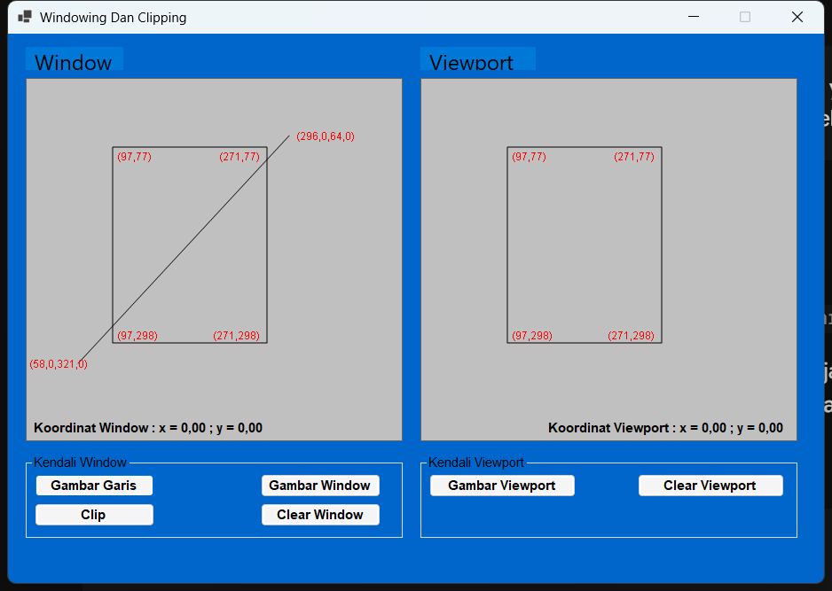
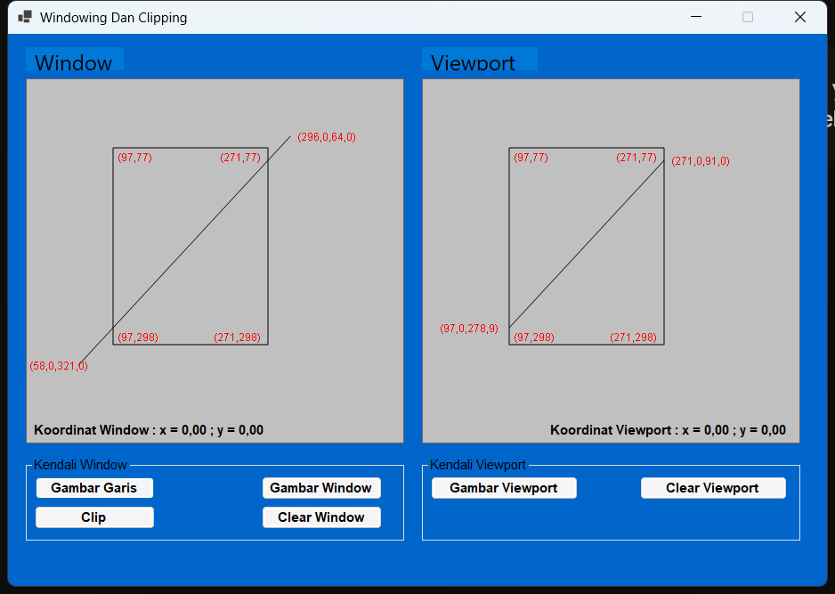

# Windowing Dan Clipping — Praktikum 3 Grafika Komputer

Aplikasi desktop **C# WinForms (.NET / GDI+)** untuk mendemonstrasikan **windowing**, **clipping garis dengan algoritma Cohen-Sutherland**, dan **transformasi koordinat Window-to-Viewport**.

Antarmuka aplikasi dibangun sepenuhnya secara programatik di `Form1.cs` dan mengikuti tata letak gambar referensi modul Praktikum 3 (3.4):

- Form biru `920 × 620` (client area) dengan judul **Windowing Dan Clipping**.
- Dua kanvas abu-abu `425 × 410`: **Window** (kiri) dan **Viewport** (kanan).
- Dua GroupBox kendali: **Kendali Window** dan **Kendali Viewport**.
- Label koordinat merah untuk sudut window/viewport dan ujung garis.
- Back-buffer `Bitmap` pada setiap kanvas agar gambar tetap ada saat form di-minimize atau di-refresh.

## Nilai Default

Agar hasilnya langsung sama dengan contoh modul:

| Objek | Koordinat |
|---|---|
| Window | `(97, 77)` sampai `(271, 298)` |
| Garis | `(58, 321)` sampai `(296, 64)` |
| Viewport | `(97, 77)` sampai `(271, 298)` |

Hasil clipping yang diharapkan:

- Titik potong kiri-bawah: **`(97.0, 278.9)`**
- Titik potong kanan-atas: **`(271.0, 91.0)`**

## Fitur

- Algoritma **Cohen–Sutherland** dengan *outcode* 4-bit (`INSIDE`, `LEFT`, `RIGHT`, `BOTTOM`, `TOP`).
- Menghormati sistem koordinat GDI+: `y < ymin` adalah `TOP`, `y > ymax` adalah `BOTTOM`.
- Transformasi Window-to-Viewport:
  - `xv = xvmin + (xw - xwmin) × (xvmax - xvmin) / (xwmax - xwmin)`
  - `yv = yvmin + (yw - ywmin) × (yvmax - yvmin) / (ywmax - ywmin)`
- Interaksi mouse:
  - Klik **Gambar Window** lalu *drag* pada kanvas kiri untuk membuat window baru.
  - Klik **Gambar Garis** lalu *drag* pada kanvas kiri untuk membuat garis baru.
  - Klik **Gambar Viewport** lalu *drag* pada kanvas kanan untuk membuat viewport baru.
  - Label koordinat di dalam kanvas diperbarui *real-time* saat mouse bergerak.
- **Clip** memotong garis dan memproyeksikannya ke viewport.
- **Clear Window** dan **Clear Viewport** mengosongkan kanvas masing-masing.
- Preview *rubber band* saat melakukan drag.

## Menjalankan Program

Dari folder repositori:

```powershell
cd C:\Users\HP\source\repos\AuliaPrakGrafkom3
dotnet build
dotnet run --project AuliaPrakGrafkom3
```

Atau langsung dari folder proyek:

```powershell
cd AuliaPrakGrafkom3
dotnet run
```

Jika ingin membuat proyek WinForms baru dari nol:

```powershell
dotnet new winforms -n AuliaPrakGrafkom3
cd AuliaPrakGrafkom3
dotnet run
```

> Catatan: `dotnet new winforms` membuat kerangka proyek baru. Untuk repositori ini, cukup gunakan perintah `dotnet run` karena `Program.cs` dan `Form1.cs` sudah tersedia.

## Struktur Proyek

| Berkas | Keterangan |
|---|---|
| `AuliaPrakGrafkom3/Program.cs` | Titik masuk aplikasi (`Application.Run`). |
| `AuliaPrakGrafkom3/Form1.cs` | Seluruh UI, kanvas back-buffer, interaksi mouse, algoritma Cohen–Sutherland, transformasi Window-to-Viewport, dan label koordinat merah. |
| `LAPORAN.md` | Laporan praktikum lengkap: tujuan, dasar teori, penjelasan kode, langkah praktikum, perhitungan manual, pembahasan, dan kesimpulan. |
| `docs/screenshot.png` | Tampilan awal aplikasi (window, garis, dan viewport default). |
| `docs/screenshot-clip.png` | Tampilan setelah tombol **Clip** ditekan. |

## Tampilan Aplikasi





## Dokumentasi

Laporan lengkap tersedia di [`LAPORAN.md`](LAPORAN.md), termasuk pembuktian matematis titik potong `(97.0, 278.9)` dan `(271.0, 91.0)`.
