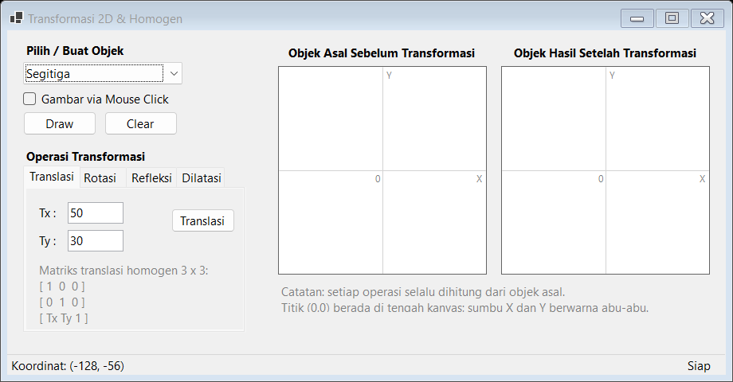
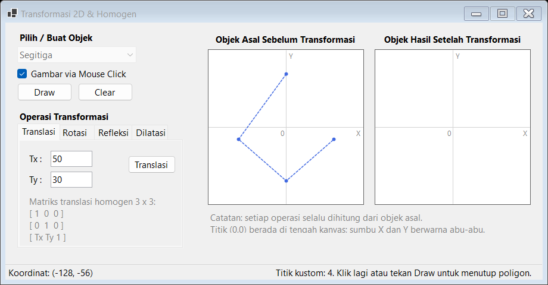
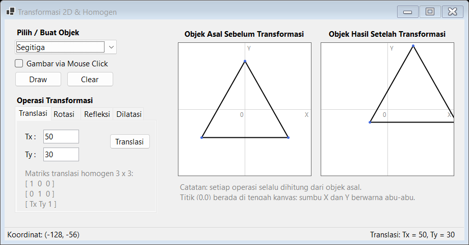
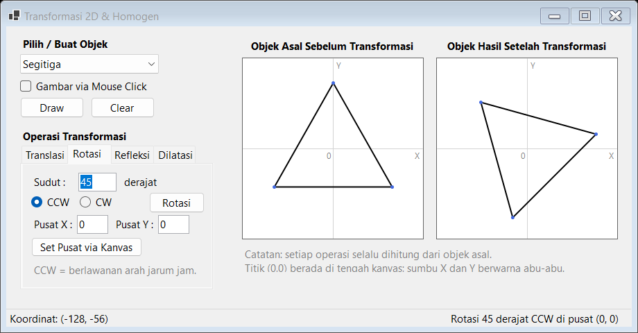
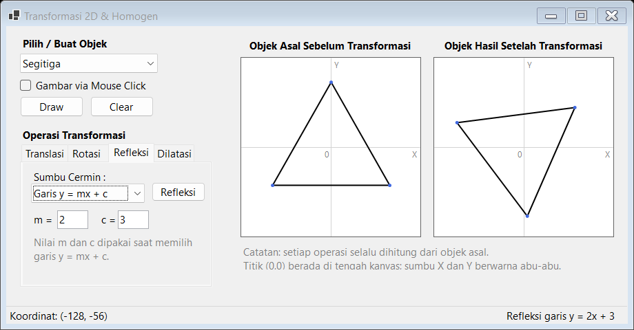
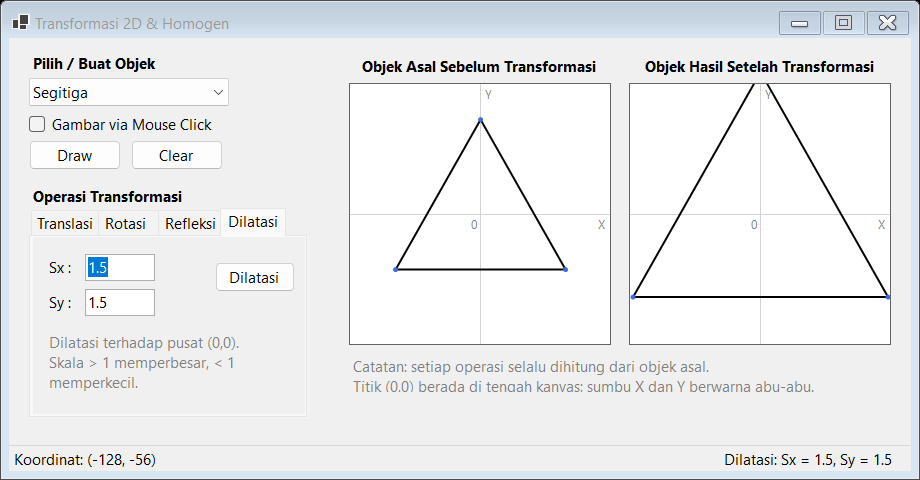
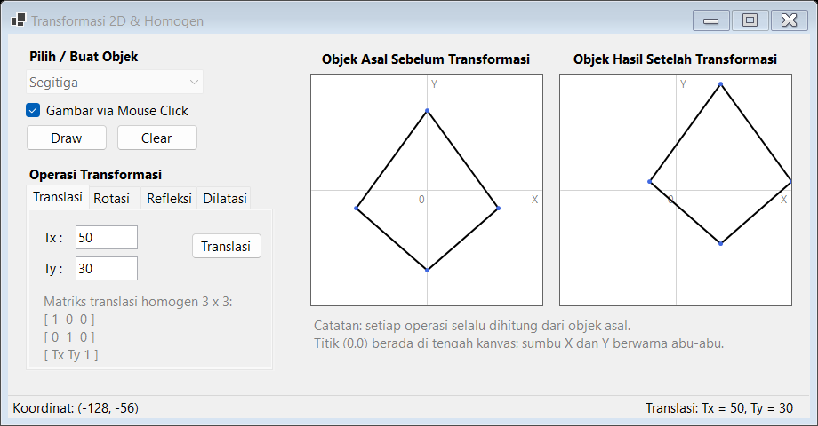

# LAPORAN PRAKTIKUM 4
## Transformasi Dua Dimensi (Dasar & Homogen)

| | |
|---|---|
| **Mata Kuliah** | Grafika Komputer |
| **Judul Praktikum** | Transformasi Dua Dimensi (Dasar & Homogen) |
| **Nama** | `[Isi Nama Mahasiswa]` |
| **NIM** | `[Isi NIM]` |
| **Kelas** | `[Isi Kelas]` |
| **Tanggal Praktikum** | `[Isi Tanggal]` |
| **Aplikasi** | `AuliaPrakGrafkom4` — C# Windows Forms (.NET 10 / GDI+) |

---

## 4.1 Tujuan Praktikum

1. Memahami konsep transformasi dua dimensi dasar: **translasi, rotasi, refleksi, dan dilatasi**.
2. Memahami penggunaan **koordinat homogen** sehingga seluruh transformasi affine dapat dinyatakan sebagai perkalian matriks **3 × 3**.
3. Mengimplementasikan **Algoritma 4.1 (perkalian matriks)** untuk menghitung koordinat baru dari sekumpulan titik objek.
4. Menerapkan **komposisi matriks** pada rotasi terhadap pusat sembarang dan refleksi terhadap garis sembarang `y = mx + c`.
5. Menampilkan objek asal dan objek hasil transformasi pada dua kanvas GDI+ yang dilengkapi sumbu koordinat Kartesius.
6. Membuat aplikasi desktop interaktif sederhana dengan Windows Forms, termasuk penggambaran objek melalui pilihan preset maupun klik mouse.

---

## 4.2 Teori Singkat Transformasi 2D & Homogen

### 4.2.1 Titik, Koordinat Kartesius, dan Koordinat Homogen

Sebuah titik pada bidang dua dimensi dapat ditulis sebagai pasangan `(x, y)`. Agar operasi translasi dapat dilakukan dengan perkalian matriks (bukan penjumlahan), titik tersebut direpresentasikan dalam **koordinat homogen**:

```text
p = [ x   y   1 ]
```

Seluruh titik objek disusun menjadi matriks `P` berukuran **N × 3**:

```text
P = [ x1  y1  1 ]
    [ x2  y2  1 ]
    [ ...      ]
    [ xN  yN  1 ]
```

Dengan demikian, transformasi dapat dihitung sekaligus untuk semua titik:

```text
P' = P · M
```

dengan `M` adalah matriks transformasi homogen berukuran **3 × 3**.

> **Catatan konvensi.** Aplikasi ini menggunakan **vektor baris** (`P' = P · M`), sehingga bentuk matriksnya adalah transpos dari penulisan buku yang menggunakan vektor kolom (`P' = M · P`). Keduanya benar selama digunakan secara konsisten. Contoh perhitungan pada laporan ini mengikuti konvensi vektor baris agar sesuai dengan kode program.

### 4.2.2 Matriks Transformasi Dasar 3 × 3

#### a. Translasi `(Tx, Ty)`

```text
T(Tx, Ty) = [ 1   0   0 ]
            [ 0   1   0 ]
            [ Tx  Ty  1 ]
```

Titik `(x, y)` berubah menjadi `(x + Tx, y + Ty)`.

#### b. Rotasi terhadap titik asal `(0, 0)`

Untuk rotasi berlawanan arah jarum jam (**CCW**) sebesar `θ`:

```text
R(θ) = [  cos θ   sin θ   0 ]
       [ -sin θ   cos θ   0 ]
       [    0       0     1 ]
```

Sehingga:

```text
x' = x · cos θ − y · sin θ
y' = x · sin θ + y · cos θ
```

Rotasi searah jarum jam (**CW**) diperoleh dengan mengganti `θ` menjadi `−θ`.

#### c. Dilatasi (penskalaan) `(Sx, Sy)`

```text
S(Sx, Sy) = [ Sx   0   0 ]
            [  0  Sy   0 ]
            [  0   0   1 ]
```

Titik `(x, y)` berubah menjadi `(x · Sx, y · Sy)`. Jika `Sx = Sy`, disebut penskalaan seragam (*uniform scaling*).

#### d. Refleksi terhadap sumbu-sumbu utama

| Sumbu cermin | Matriks | Pemetaan titik |
|---|---|---|
| Sumbu X (`y = 0`) | `[1 0 0; 0 -1 0; 0 0 1]` | `(x, y) → (x, −y)` |
| Sumbu Y (`x = 0`) | `[-1 0 0; 0 1 0; 0 0 1]` | `(x, y) → (−x, y)` |
| Garis `y = x` | `[0 1 0; 1 0 0; 0 0 1]` | `(x, y) → (y, x)` |
| Garis `y = −x` | `[0 -1 0; -1 0 0; 0 0 1]` | `(x, y) → (−y, −x)` |

### 4.2.3 Rotasi terhadap Pusat Sembarang `(m, n)`

Rotasi terhadap pusat `(m, n)` dilakukan dengan tiga langkah:

1. Translasi pusat `(m, n)` ke titik asal: `T(−m, −n)`.
2. Rotasi terhadap titik asal: `R(θ)`.
3. Translasi kembali ke posisi semula: `T(m, n)`.

Karena menggunakan vektor baris, komposisinya ditulis:

```text
M = T(−m, −n) · R(θ) · T(m, n)
```

Urutan perkalian tersebut penting dan tidak komutatif.

### 4.2.4 Refleksi terhadap Garis Sembarang `y = mx + c`

Misalkan `α = arctan(m)` adalah sudut kemiringan garis. Refleksi dilakukan melalui lima langkah:

1. Geser garis ke bawah sejauh `c`: `T(0, −c)`.
2. Putar garis sehingga berimpit dengan sumbu X: `R(−α)`.
3. Cerminkan terhadap sumbu X: `Ref_X`.
4. Putar kembali ke kemiringan semula: `R(α)`.
5. Geser kembali ke atas sejauh `c`: `T(0, c)`.

Matriks kompositnya:

```text
M = T(0, −c) · R(−α) · Ref_X · R(α) · T(0, c)
```

Secara analitis, hasil pemetaan titik `(x, y)` adalah:

```text
x' = x − 2m(mx − y + c) / (1 + m²)
y' = y + 2(mx − y + c) / (1 + m²)
```

Rumus ini dapat digunakan untuk memverifikasi hasil program.

### 4.2.5 Algoritma 4.1 — Perkalian Matriks

Jika `A` berukuran `rA × cA` dan `B` berukuran `rB × cB`, perkalian `C = A · B` hanya dapat dilakukan bila `cA = rB`. Hasilnya berukuran `rA × cB` dengan:

```text
C[i, j] = Σ (A[i, k] · B[k, j])   untuk k = 0 .. cA−1
```

Pseudocode:

```text
for i = 0 to rA - 1
    for j = 0 to cB - 1
        C[i, j] = 0
        for k = 0 to cA - 1
            C[i, j] = C[i, j] + A[i, k] * B[k, j]
```

Pada aplikasi ini, matriks `P` berukuran `N × 3` dan matriks transformasi `M` berukuran `3 × 3`, sehingga hasil `P'` juga berukuran `N × 3`.

### 4.2.6 Koordinat Layar dan Koordinat Kartesius

Layar Windows menggunakan sumbu Y yang mengarah **ke bawah**, sedangkan matematika Kartesius menggunakan sumbu Y yang mengarah **ke atas**. Karena itu, kanvas berukuran 260 × 260 piksel memakai titik tengah `(130, 130)` sebagai titik `(0, 0)`, lalu dilakukan konversi:

```text
xpiksel = 130 + x
ypiksel = 130 − y
```

Sebaliknya, posisi kursor mouse dikonversi menjadi koordinat Kartesius:

```text
x = xpiksel − 130
y = 130 − ypiksel
```

---

## 4.3 Perancangan Aplikasi

### 4.3.1 Struktur Antarmuka

Form utama berjudul **“Transformasi 2D & Homogen”**, berukuran 920 × 480 piksel, menggunakan `FormBorderStyle.FixedSingle` dan `StartPosition.CenterScreen`. Seluruh kontrol dibuat secara programatik di `Form1.cs`.

| Kontrol | Nama | Posisi / Ukuran | Keterangan |
|---|---|---|---|
| ComboBox | `cmbObjek` | (20, 40), 200 × 25 | Pilihan `Segitiga`, `Persegi`, `Jajar Genjang` |
| CheckBox | `chkMouseClick` | (20, 75) | Mode menggambar poligon via klik mouse |
| Button | `btnDraw` | (20, 102), 92 × 30 | Menggambar objek asal |
| Button | `btnClear` | (122, 102), 92 × 30 | Membersihkan kanvas |
| TabControl | `tabTransformasi` | (20, 170), 280 × 210 | Empat tab operasi transformasi |
| Panel | `pnlAsal` | (340, 45), kanvas 260 × 260 | Objek asal |
| Panel | `pnlHasil` | (620, 45), kanvas 260 × 260 | Objek hasil transformasi |
| StatusStrip | — | bawah form | Koordinat kursor dan status operasi |

Tab `Translasi` berisi input `Tx`, `Ty`, dan tombol **Translasi**. Tab `Rotasi` berisi input sudut (derajat), pilihan **CCW/CW**, input pusat `X` dan `Y`, tombol **Rotasi**, serta tombol **Set Pusat via Kanvas**. Tab `Refleksi` berisi pilihan sumbu cermin, input `m` dan `c`, serta tombol **Refleksi**. Tab `Dilatasi` berisi input `Sx`, `Sy`, dan tombol **Dilatasi**.



*Gambar 4.1 — Tampilan awal aplikasi. Titik (0,0) berada di tengah kedua kanvas.*

### 4.3.2 Alur Kerja Program

1. Pengguna memilih bentuk pada `cmbObjek`, lalu menekan **Draw** untuk menggambar objek preset; **atau** mencentang **Gambar via Mouse Click**, mengklik minimal tiga titik pada kanvas asal, lalu menekan **Draw** untuk menutup poligon.
2. Objek asal disimpan sebagai `List<PointF>` dalam koordinat Kartesius relatif terhadap titik tengah kanvas.
3. Pengguna memilih tab transformasi, mengisi parameter, lalu menekan tombol operasi.
4. Program menyusun matriks transformasi homogen 3 × 3, mengalikannya dengan matriks titik `N × 3`, lalu menyimpan hasilnya.
5. Objek hasil digambar ulang pada `pnlHasil` melalui event `Paint`.
6. Koordinat kursor ditampilkan secara *real-time* pada `StatusStrip` saat mouse bergerak di atas kanvas.

### 4.3.3 Struktur Data dan Event

| Data / Event | Jenis | Fungsi |
|---|---|---|
| `originalPoints` | `List<PointF>` | Titik-titik objek asal |
| `pendingPoints` | `List<PointF>` | Titik sementara pada mode klik mouse |
| `resultPoints` | `List<PointF>` | Titik-titik objek hasil |
| `PnlAsal_Paint` / `PnlHasil_Paint` | Event `Paint` | Menggambar ulang sumbu dan objek |
| `Pnl_MouseDown` | Event mouse | Menambah titik atau memilih pusat rotasi |
| `Pnl_MouseMove` | Event mouse | Memperbarui status koordinat |
| `BtnTranslasi_Click`, dst. | Event klik | Menjalankan operasi transformasi |

Karena gambar selalu dibangun ulang dari data pada event `Paint`, gambar **tidak hilang** ketika form di-refresh, dipindah, atau tertutup jendela lain.

---

## 4.4 Penjelasan Kode Program

### 4.4.1 Fungsi Perkalian Matriks (Algoritma 4.1)

```csharp
private static double[,] MultiplyMatrix(double[,] a, double[,] b)
{
    int aRows = a.GetLength(0);
    int aCols = a.GetLength(1);
    int bRows = b.GetLength(0);
    int bCols = b.GetLength(1);

    if (aCols != bRows)
        throw new ArgumentException(
            "Jumlah kolom matriks A harus sama dengan jumlah baris matriks B.");

    double[,] hasil = new double[aRows, bCols];

    for (int i = 0; i < aRows; i++)
    {
        for (int j = 0; j < bCols; j++)
        {
            double jumlah = 0;
            for (int k = 0; k < aCols; k++)
                jumlah += a[i, k] * b[k, j];

            hasil[i, j] = jumlah;
        }
    }

    return hasil;
}
```

Fungsi ini persis mengikuti Algoritma 4.1. Pengecekan `aCols != bRows` mencegah kesalahan dimensi. Fungsi yang sama dipakai untuk:

- mengalikan matriks titik `N × 3` dengan matriks transformasi `3 × 3`;
- mengalikan beberapa matriks transformasi saat memberlakukan komposisi.

### 4.4.2 Matriks Translasi dan Rotasi

```csharp
private static double[,] CreateTranslationMatrix(double tx, double ty)
{
    // Vektor baris: P' = P x M
    return new double[,]
    {
        { 1, 0, 0  },
        { 0, 1, 0  },
        { tx, ty, 1 }
    };
}

private static double[,] CreateRotationMatrix(double radian)
{
    double cos = Math.Cos(radian);
    double sin = Math.Sin(radian);

    // Rotasi CCW, konvensi vektor baris
    return new double[,]
    {
        {  cos, sin, 0 },
        { -sin, cos, 0 },
        {  0,    0,  1 }
    };
}
```

Perhatikan bahwa `Tx` dan `Ty` berada pada **baris ketiga** karena titik ditulis sebagai vektor baris. Demikian pula tanda `sin` pada matriks rotasi mengikuti konvensi tersebut.

### 4.4.3 Penerapan Matriks ke Seluruh Titik

```csharp
private void ApplyMatrix(double[,] matrix, string keterangan)
{
    int n = originalPoints.Count;

    // Susun titik menjadi matriks N x 3: [x  y  1]
    double[,] titik = new double[n, 3];
    for (int i = 0; i < n; i++)
    {
        titik[i, 0] = originalPoints[i].X;
        titik[i, 1] = originalPoints[i].Y;
        titik[i, 2] = 1;
    }

    // P' = P x M
    double[,] hasil = MultiplyMatrix(titik, matrix);

    resultPoints.Clear();
    for (int i = 0; i < n; i++)
    {
        resultPoints.Add(new PointF(
            (float)hasil[i, 0],
            (float)hasil[i, 1]));
    }

    lblInfo.Text = keterangan;
    pnlHasil.Invalidate();
}
```

Karena koordinat homogen `w = 1`, koordinat akhir cukup diambil dari kolom 0 dan 1. Pemanggilan `Invalidate()` memicu event `Paint` sehingga kanvas hasil langsung diperbarui.

### 4.4.4 Translasi

```csharp
double[,] matrix =
{
    { 1, 0, 0  },
    { 0, 1, 0  },
    { tx, ty, 1 }
};

ApplyMatrix(matrix, $"Translasi: Tx = {tx}, Ty = {ty}");
```

### 4.4.5 Rotasi dengan Pusat Sembarang

```csharp
double radian = sudut * Math.PI / 180.0;
if (rbCW.Checked)
    radian = -radian;      // CW = sudut negatif

double[,] t1 = CreateTranslationMatrix(-pusatX, -pusatY);
double[,] r  = CreateRotationMatrix(radian);
double[,] t2 = CreateTranslationMatrix(pusatX, pusatY);

double[,] matrix = MultiplyMatrix(MultiplyMatrix(t1, r), t2);
```

Komposisi `T(−m, −n) · R(θ) · T(m, n)` membuat rotasi berpusat di `(m, n)`. Bila pusat `(0, 0)`, hasilnya sama dengan rotasi dasar terhadap titik asal.

Pusat rotasi dapat diisi manual pada `txtPusatX` dan `txtPusatY`, atau diambil otomatis dengan menekan **Set Pusat via Kanvas** lalu mengklik salah satu kanvas.

### 4.4.6 Refleksi

Refleksi sumbu utama langsung menggunakan matriks yang telah dijelaskan pada Tabel 4.2. Untuk garis `y = mx + c`, program membentuk komposisi lima matriks:

```csharp
double alpha = Math.Atan(m);

double[,] t1     = CreateTranslationMatrix(0, -c);
double[,] rMinus = CreateRotationMatrix(-alpha);
double[,] refX   = { { 1, 0, 0 }, { 0, -1, 0 }, { 0, 0, 1 } };
double[,] rPlus  = CreateRotationMatrix(alpha);
double[,] t2     = CreateTranslationMatrix(0, c);

double[,] matrix = MultiplyMatrix(
    MultiplyMatrix(
        MultiplyMatrix(
            MultiplyMatrix(t1, rMinus),
            refX),
        rPlus),
    t2);
```

### 4.4.7 Menggambar Ulang dengan Event `Paint`

```csharp
private void PnlAsal_Paint(object? sender, PaintEventArgs e)
{
    e.Graphics.SmoothingMode = SmoothingMode.AntiAlias;
    DrawAxes(e.Graphics, pnlAsal.ClientSize);

    if (originalPoints.Count > 0)
        DrawPolygon(e.Graphics, originalPoints, Color.Black, true);

    if (pendingPoints.Count > 0)
        DrawPendingPoints(e.Graphics);
}
```

Sumbu digambar dengan `Pen(Color.LightGray, 1f)` pada posisi tengah kanvas. Poligon hasil digambar dengan `Pen(Color.Black, 2f)`. Titik sudut diberi penanda biru agar mudah diamati.

### 4.4.8 Penggambaran Objek via Mouse

Saat `chkMouseClick` dicentang, setiap klik kiri pada `pnlAsal` menambahkan satu titik:

```csharp
if (sender == pnlAsal && chkMouseClick.Checked)
{
    pendingPoints.Add(ScreenToWorld(e.Location));
    pnlAsal.Invalidate();
}
```

Titik-titik sementara ditampilkan sebagai garis putus-putus biru. Setelah minimal tiga titik, tombol **Draw** menyalin `pendingPoints` menjadi `originalPoints` dan menutup poligon. Mode ini memungkinkan pengguna membuat bentuk bebas, misalnya segi empat atau poligon tidak beraturan.



*Gambar 4.2 — Pratinjau titik dan garis saat mode “Gambar via Mouse Click” aktif.*

---

## 4.5 Contoh Perhitungan Matriks

Contoh menggunakan objek segitiga preset aplikasi dengan titik:

```text
A = (0, 95)
B = (−85, −55)
C = (85, −55)
```

Titik-titik ditulis dalam koordinat homogen:

```text
A = [ 0   95  1 ]
B = [ −85 −55 1 ]
C = [ 85  −55 1 ]
```

### 4.5.1 Translasi `(Tx, Ty) = (50, 30)`

Matriks translasi:

```text
T = [ 1   0   0 ]
    [ 0   1   0 ]
    [ 50  30  1 ]
```

Perhitungan titik A:

```text
A' = [ 0  95  1 ] · T
   = [ 0·1 + 95·0 + 1·50,   0·0 + 95·1 + 1·30,   0·0 + 95·0 + 1·1 ]
   = [ 50  125  1 ]
```

Hasil lengkap:

| Titik | Asal | Hasil |
|---|---|---|
| A | (0, 95) | (50, 125) |
| B | (−85, −55) | (−35, −25) |
| C | (85, −55) | (135, −25) |



*Gambar 4.3 — Hasil translasi (50, 30).*

### 4.5.2 Rotasi 45° CCW terhadap Titik Asal

Dengan `cos 45° = sin 45° = 0,7071`:

```text
R = [  0,7071  0,7071  0 ]
    [ −0,7071  0,7071  0 ]
    [    0       0     1 ]
```

Titik A:

```text
x' = 0 · 0,7071 − 95 · 0,7071 = −67,18
y' = 0 · 0,7071 + 95 · 0,7071 =  67,18
A' = (−67,18, 67,18)
```

Titik B:

```text
x' = (−85)(0,7071) − (−55)(0,7071) = −21,21
y' = (−85)(0,7071) + (−55)(0,7071) = −98,99
B' = (−21,21, −98,99)
```

Titik C:

```text
x' = 85 · 0,7071 − (−55)(0,7071) = 98,99
y' = 85 · 0,7071 + (−55)(0,7071) = 21,21
C' = (98,99, 21,21)
```



*Gambar 4.4 — Hasil rotasi 45° CCW terhadap titik asal.*

### 4.5.3 Rotasi 90° CCW dengan Pusat `(20, 10)`

Langkah manual untuk titik A `(0, 95)`:

1. Translasi pusat ke titik asal: `(0, 95) + (−20, −10) = (−20, 85)`.
2. Rotasi 90° CCW: `(x, y) → (−y, x)` sehingga menjadi `(−85, −20)`.
3. Translasi kembali: `(−85, −20) + (20, 10) = (−65, −10)`.

Matriks komposit yang diperoleh:

```text
M = T(−20, −10) · R(90°) · T(20, 10)

  = [  0   1   0 ]
    [ −1   0   0 ]
    [ 30 −10   1 ]
```

Verifikasi:

```text
[ 0  95  1 ] · M
= 0·[0 1 0] + 95·[−1 0 0] + 1·[30 −10 1]
= [ −95  0  0 ] + [ 30 −10  1 ]
= [ −65 −10  1 ]
```

Hasil ini sesuai dengan perhitungan manual.

### 4.5.4 Refleksi terhadap Sumbu Utama

| Titik | Asal | Sumbu X | Sumbu Y | Garis `y = x` | Garis `y = −x` |
|---|---|---|---|---|---|
| A | (0, 95) | (0, −95) | (0, 95) | (95, 0) | (−95, 0) |
| B | (−85, −55) | (−85, 55) | (85, −55) | (−55, −85) | (55, 85) |
| C | (85, −55) | (85, 55) | (−85, −55) | (−55, 85) | (55, −85) |

### 4.5.5 Refleksi terhadap Garis `y = 2x + 3`

Diketahui `m = 2`, `c = 3`, sehingga:

```text
α = arctan(2) = 63,4349°
sin 2α = 0,8
cos 2α = −0,6
```

Matriks komposit hasil lima langkah:

```text
M = [ −0,6  0,8  0 ]
    [  0,8  0,6  0 ]
    [ −2,4  1,2  1 ]
```

Perhitungan titik A `(0, 95)`:

```text
A' = [ 0  95  1 ] · M
   = [ 0(−0,6) + 95(0,8) + 1(−2,4),
       0(0,8)  + 95(0,6) + 1(1,2),
       1 ]
   = [ 73,6  58,2  1 ]
```

Verifikasi dengan rumus analitis:

```text
d  = mx − y + c = 2(0) − 95 + 3 = −92
x' = 0 − 2(2)(−92) / (1 + 4) = 73,6
y' = 95 + 2(−92) / (1 + 4) = 58,2
```

Hasil lengkap:

| Titik | Asal | Hasil |
|---|---|---|
| A | (0, 95) | (73,6, 58,2) |
| B | (−85, −55) | (4,6, −99,8) |
| C | (85, −55) | (−97,4, 36,2) |



*Gambar 4.5 — Hasil refleksi terhadap garis y = 2x + 3.*

### 4.5.6 Dilatasi `(Sx, Sy) = (1,5, 1,5)`

Matriks dilatasi:

```text
S = [ 1,5  0   0 ]
    [  0  1,5  0 ]
    [  0   0   1 ]
```

Perhitungan titik A:

```text
A' = [ 0  95  1 ] · S = [ 0  142,5  1 ]
```

Hasil lengkap:

| Titik | Asal | Hasil |
|---|---|---|
| A | (0, 95) | (0, 142,5) |
| B | (−85, −55) | (−127,5, −82,5) |
| C | (85, −55) | (127,5, −82,5) |



*Gambar 4.6 — Hasil dilatasi dengan skala 1,5 pada kedua sumbu.*

### 4.5.7 Ringkasan Hasil Transformasi

| Operasi | Parameter | Hasil untuk A, B, C |
|---|---|---|
| Translasi | `Tx = 50`, `Ty = 30` | (50, 125), (−35, −25), (135, −25) |
| Rotasi CCW | `θ = 45°`, pusat (0, 0) | (−67,18, 67,18), (−21,21, −98,99), (98,99, 21,21) |
| Rotasi CW | `θ = 45°`, pusat (0, 0) | (67,18, 67,18), (−98,99, 21,21), (21,21, −98,99) |
| Refleksi | Sumbu X | (0, −95), (−85, 55), (85, 55) |
| Refleksi | Sumbu Y | (0, 95), (85, −55), (−85, −55) |
| Refleksi | `y = x` | (95, 0), (−55, −85), (−55, 85) |
| Refleksi | `y = mx + c`, `m = 2`, `c = 3` | (73,6, 58,2), (4,6, −99,8), (−97,4, 36,2) |
| Dilatasi | `Sx = 1,5`, `Sy = 1,5` | (0, 142,5), (−127,5, −82,5), (127,5, −82,5) |

---

## 4.6 Hasil Pengujian

Pengujian dilakukan dengan menjalankan aplikasi menggunakan `dotnet run` dan memeriksa hasil gambar serta nilai koordinat pada status bar.

| No | Skenario | Hasil yang Diharapkan | Hasil |
|---|---|---|---|
| 1 | Menekan **Draw** dengan preset Segitiga | Segitiga tampil pada kanvas asal | Berhasil |
| 2 | Mencentang **Gambar via Mouse Click**, mengklik 4 titik, lalu **Draw** | Poligon tertutup tampil pada kanvas asal | Berhasil |
| 3 | Translasi (50, 30) | Objek bergeser 50 satuan ke kanan dan 30 satuan ke atas | Berhasil |
| 4 | Rotasi 45° CCW pusat (0, 0) | Objek berputar berlawanan arah jarum jam | Berhasil |
| 5 | Rotasi 90° CCW pusat (50, 50) | Objek berputar terhadap pusat yang dipilih via kanvas | Berhasil |
| 6 | Refleksi sumbu X, sumbu Y, `y = x`, `y = −x` | Objek tercermin sesuai sumbu | Berhasil |
| 7 | Refleksi `y = 2x + 3` | Hasil sama dengan perhitungan analitis | Berhasil |
| 8 | Dilatasi (1,5, 1,5) | Objek diperbesar 1,5 kali | Berhasil |
| 9 | Input desimal memakai koma (`1,5`) | Nilai tetap terbaca dengan benar | Berhasil |
| 10 | Menekan **Clear** | Kedua kanvas kosong kembali | Berhasil |
| 11 | Menggerakkan mouse di atas kanvas | Status bar menampilkan koordinat Kartesius | Berhasil |
| 12 | Me-refresh form | Gambar tetap tampil karena digambar ulang pada event `Paint` | Berhasil |



*Gambar 4.7 — Poligon hasil gambar via mouse setelah ditranslasi.*

---

## 4.7 Kesimpulan

1. Transformasi dua dimensi dapat diimplementasikan secara seragam menggunakan **matriks homogen 3 × 3** dan satu fungsi perkalian matriks.
2. Penggunaan **koordinat homogen** memungkinkan translasi diperlakukan sama seperti rotasi, refleksi, dan dilatasi, yaitu melalui perkalian matriks.
3. **Urutan komposisi matriks** sangat menentukan hasil. Rotasi terhadap pusat sembarang memerlukan `T(−m, −n) · R(θ) · T(m, n)`, sedangkan refleksi terhadap garis sembarang memerlukan lima matriks berurutan.
4. Konvensi vektor baris (`P' = P · M`) harus konsisten dengan bentuk matriks yang digunakan. Pada konvensi ini, `Tx` dan `Ty` berada di baris ketiga matriks translasi.
5. Pemisahan **data objek** dan **proses menggambar** melalui event `Paint` membuat gambar tetap bertahan saat kanvas di-refresh.
6. Aplikasi Windows Forms dengan GDI+ mampu memvisualisasikan objek asal dan hasil transformasi secara interaktif, sehingga memudahkan verifikasi perhitungan matriks.

---

## Lampiran — Cara Menjalankan

```powershell
# Dari folder solusi
dotnet run --project .\AuliaPrakGrafkom4\AuliaPrakGrafkom4.csproj
```

Atau buka `AuliaPrakGrafkom4.slnx` di Visual Studio, lalu tekan **F5**.

### Struktur Berkas

```text
AuliaPrakGrafkom4/
├── AuliaPrakGrafkom4.slnx
├── AuliaPrakGrafkom4/
│   ├── Program.cs
│   ├── Form1.cs              ← seluruh UI, event, dan algoritma transformasi
│   ├── Form1.Designer.cs
│   └── AuliaPrakGrafkom4.csproj
├── docs/
│   └── screenshots/          ← tangkapan layar untuk laporan
└── Laporan_Praktikum_4.md
```

### Catatan Penggunaan

- Titik `(0, 0)` selalu berada di tengah kanvas, ditandai perpotongan sumbu abu-abu.
- Setiap tombol operasi selalu menghitung dari **objek asal**, bukan dari hasil transformasi sebelumnya.
- Untuk rotasi dengan pusat sembarang, isi `Pusat X` dan `Pusat Y`, atau tekan **Set Pusat via Kanvas** lalu klik kanvas.
- Untuk refleksi garis sembarang, pilih `Garis y = mx + c`; input `m` dan `c` akan aktif.
- Nilai desimal dapat ditulis dengan titik (`1.5`) maupun koma (`1,5`).
